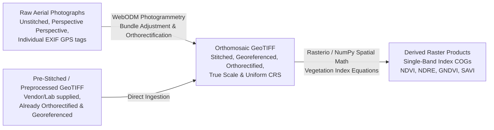
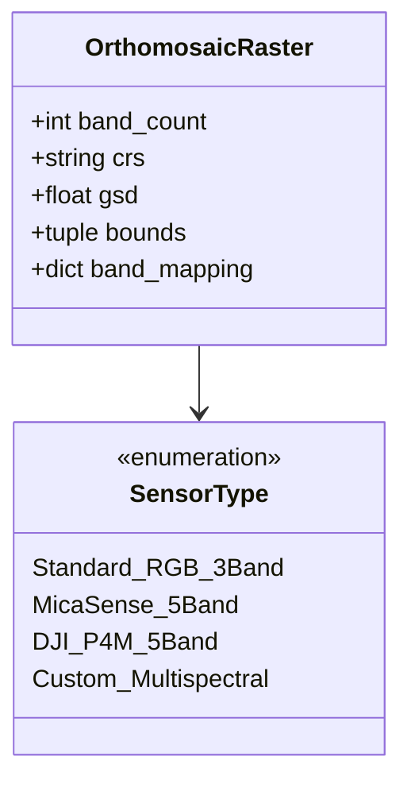

# AgriDrone AutoMap — Data & File Requirements Specification

## 1. File Categorization & Fundamental Conceptual Distinctions

In an agricultural drone mapping platform, confusing raw photographs with georeferenced raster products results in catastrophic architectural and processing failures. The system recognizes three fundamentally distinct geospatial data classes:



### Deep Conceptual Breakdown:
1. **Raw Drone Photographs (Unstitched Aerial Images)**:
   - *Nature*: Hundreds or thousands of individual images captured during flight. Each image possesses central perspective distortion, radial lens distortion, tilt, and terrain relief displacement.
   - *Spatial Context*: Contains point-location EXIF GPS coordinates (camera position at exposure), but the image pixels themselves are *not* georeferenced to the earth's surface and cannot be overlaid onto a map.
   - *Processing Requirement*: **Must be processed through WebODM (Photogrammetry)** to perform Structure-from-Motion (SfM), point-cloud densification, digital surface modeling, and orthorectification.
2. **Orthomosaic GeoTIFFs (Stitched, Georeferenced Orthophotos)**:
   - *Nature*: A single, seamless, map-accurate raster created by geometrically correcting (orthorectifying) aerial photographs such that scale is uniform and terrain displacement is eliminated.
   - *Spatial Context*: Fully georeferenced. Possesses an Affine Geotransform and a defined Coordinate Reference System (CRS). Every pixel corresponds to a precise geographic coordinate on Earth.
   - *Processing Requirement*: **Bypasses WebODM entirely**. Proceeds directly to GIS band mapping and vegetation index calculation (Page 3).
3. **Derived Raster Products (Vegetation Index Layers)**:
   - *Nature*: Single-band 32-bit floating-point rasters representing calculated mathematical indices (e.g., NDVI, NDRE) derived from the multi-band orthomosaic.
   - *Spatial Context*: Inherits identical projection, spatial extent, and resolution from the source orthomosaic. Converted into Cloud Optimized GeoTIFFs (COGs) for fast web streaming.

---

## 2. Supported File Formats & Technical Criteria

| File Category | Allowed Extensions | MIME Types / Magic Bytes | Validation Tool | Mandatory Metadata |
| :--- | :--- | :--- | :--- | :--- |
| **RGB Drone Photos** | `.jpg`, `.jpeg`, `.dng` | `image/jpeg` (`FF D8 FF`), `image/x-adobe-dng` | Pillow / ExifTool | EXIF: Latitude, Longitude, Altitude, Camera Model |
| **Multispectral Photos** | `.tif`, `.tiff`, `.dng` | `image/tiff` (`49 49 2A 00` or `4D 4D 00 2A`) | ExifTool / PyExif | EXIF/XMP: Band Name, Center Wavelength, Sunlight Sensor / Panel tags |
| **Pre-Stitched Orthomosaics** | `.tif`, `.tiff` | `image/tiff` (GeoTIFF) | GDAL / Rasterio | GeoKeyDirectoryTag, ModelTiepointTag, CRS, Affine Transform |
| **Field Boundaries** | `.geojson`, `.json` | `application/geo+json` | Shapely / GeoPandas | Polygon geometry, WGS84 (`EPSG:4326`) |
| **PDF Summary Reports** | `.pdf` | `application/pdf` (`%PDF-`) | ReportLab (Output) | Formatted report metadata, vector charts, raster thumbnails |

---

## 3. Coordinate Reference Systems (CRS) & Projection Rules

- **Source Ingestion Standards**:
  - Raw drone photo EXIF coordinates are recorded in **WGS84 ellipsoidal coordinates** (`EPSG:4326`).
  - Pre-stitched GeoTIFF rasters must be projected in a valid projected coordinate system (e.g., **Universal Transverse Mercator - UTM zones**, such as `EPSG:32632`, `EPSG:32616`, etc.) or geographic `EPSG:4326`.
- **Projection Enforcement**:
  - Rasters with undefined or missing CRS (`CRS is None`) are rejected during Page 1 pre-flight validation.
  - For accurate agricultural area calculations (hectares, acres, square meters) on Page 5, rasters in geographic coordinates (`EPSG:4326`) must be dynamically reprojected to the appropriate local UTM projection using GDAL/Rasterio to avoid ellipsoidal distortion.
- **Web Map Display (MapLibre GL JS)**:
  - Vector field boundaries and map tile overlays are rendered in **Web Mercator** (`EPSG:3857`). Raster tile services reproject COG data on-the-fly to `EPSG:3857` for seamless visual alignment.

---

## 4. Spectral Band Configurations & Recognition

Multispectral agricultural imagery varies widely based on camera hardware. The system enforces strict band structure verification:



### Recognized Sensor Band Configurations:
1. **Standard RGB (3 Bands)**:
   - Band 1: Red, Band 2: Green, Band 3: Blue.
   - *Capability*: Orthomosaic rendering only. **Ineligible for NIR-based vegetation indices** (NDVI, NDRE, GNDVI, SAVI).
2. **Standard 5-Band Multispectral (e.g., MicaSense RedEdge, DJI P4 Multispectral)**:
   - Typical sequence: Band 1: Blue, Band 2: Green, Band 3: Red, Band 4: Red Edge, Band 5: Near-Infrared (NIR).
   - *Capability*: Eligible for all platform algorithms (NDVI, NDRE, GNDVI, SAVI).
3. **Non-Standard / Arbitrary Order**:
   - The system **never assumes universal band ordering**. Page 3 provides an interactive band assignment grid allowing operators to explicitly map internal raster bands to logical spectral roles.

---

## 5. Handling NoData Values, Edge Pixels & Invalid Data

- **NoData Value Standardization**:
  - All generated index rasters use standard NoData values: `NaN` or `-9999.0` for 32-bit floating point layers.
  - The NoData mask is stored in the GeoTIFF header (`nodata` property) so GIS software and map renderers treat transparent edge margins correctly.
- **Background & Margin Masking**:
  - Pixels representing black padding outside the actual flight boundary (commonly `(0,0,0)` in RGB or edge zeros in raw orthomosaics) are masked out before statistical aggregation to prevent skewing field mean and standard deviation.
- **Clipped Boundary Statistics**:
  - When analyzing a field on Page 5, the raster is clipped to the exact field polygon vector stored in PostGIS. Only pixels whose centroids fall strictly within the polygon geometry are included in statistical histograms.

---

## 6. File-Size Limits, Storage Structure & Retention [PROPOSED]

### Proposed File Size Limits (Subject to Formal Approval):
- **Raw Photograph Batch**: Up to 1,000 photos per flight session; total upload size up to **25 GB** per survey.
- **Pre-Stitched GeoTIFF**: Single raster up to **10 GB** (files exceeding 2GB must utilize BigTIFF format).
- **Field Vector Boundary**: GeoJSON up to **5 MB**.

### Azure Blob Storage Structure:
```
agridrone-storage-account (Private Container)
├── tenants/
│   └── {tenant_id}/
│       └── farms/
│           └── {farm_id}/
│               └── fields/
│                   └── {field_id}/
│                       └── surveys/
│                           └── {survey_id}/
│                               ├── raw/                  <- Raw drone photo uploads (.jpg, .tif)
│                               ├── photogrammetry/       <- WebODM outputs (orthophoto.tif, dsm.tif)
│                               ├── indices/              <- Generated index COGs (ndvi.tif, ndre.tif)
│                               └── reports/              <- Generated ReportLab PDFs (report_20261014.pdf)
```

---

## 7. Data Provenance & Lineage Ledger

To ensure scientific repeatability and auditability, every processed artifact records a complete provenance ledger in PostgreSQL:
- **Source Artifact ID & MD5/SHA-256 Checksum**.
- **Software & Library Versions**: WebODM version, GDAL version, Rasterio version.
- **Processing Timestamp & Execution Duration**.
- **Algorithm Formula & Operational Parameters**: Formula string, band assignments, $L$-factor applied.
- **Executing Operator ID**.
