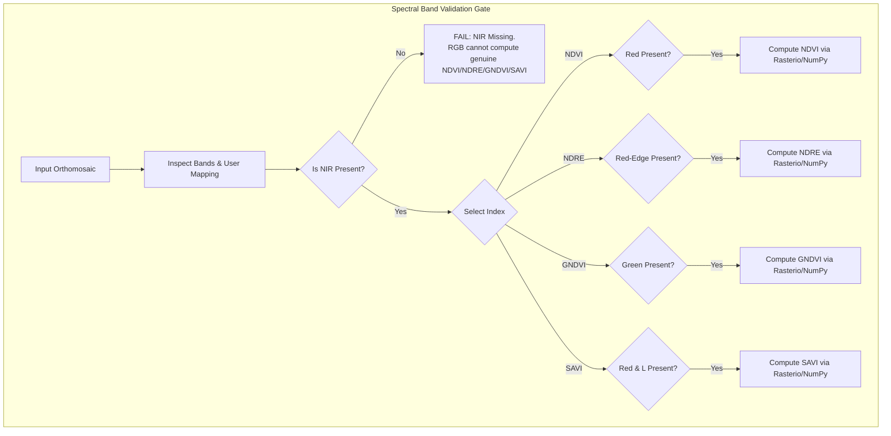

# AgriDrone AutoMap — GIS & Algorithm Validation Specification

## 1. Scientific Principles & Vegetation Index Formulas

Vegetation indices exploit the physical reflectance characteristics of photosynthetic vegetation: healthy green canopies strongly absorb visible light (particularly Red, $\sim 660\text{ nm}$, used by chlorophyll $a$ and $b$) and strongly reflect Near-Infrared energy ($\sim 700 - 900\text{ nm}$) due to scattering in the spongy mesophyll leaf structure.



---

## 2. Approved Vegetation Index Mathematical Definitions

### A. Normalized Difference Vegetation Index (NDVI)
- **Formula**:
  $$\text{NDVI} = \frac{\rho_{\text{NIR}} - \rho_{\text{Red}}}{\rho_{\text{NIR}} + \rho_{\text{Red}}}$$
- **Required Bands**: Near-Infrared ($\rho_{\text{NIR}}$) and Red ($\rho_{\text{Red}}$).
- **Physical Interpretation**: Measures general canopy greenness and photosynthetic activity. Dynamic range: $[-1.0, +1.0]$. Healthy dense crops typically fall in $+0.50$ to $+0.85$.
- **Band Availability Rule**: **RGB imagery cannot compute genuine NDVI**. Any attempt to substitute RGB "Green" or synthetic channels for NIR is scientifically invalid and strictly blocked by the system.

### B. Normalized Difference Red Edge Index (NDRE)
- **Formula**:
  $$\text{NDRE} = \frac{\rho_{\text{NIR}} - \rho_{\text{RedEdge}}}{\rho_{\text{NIR}} + \rho_{\text{RedEdge}}}$$
- **Required Bands**: Near-Infrared ($\rho_{\text{NIR}}$) and Red-Edge ($\rho_{\text{RedEdge}}$, $\sim 705 - 740\text{ nm}$).
- **Physical Interpretation**: More sensitive to chlorophyll variations in dense, high-biomass canopies where standard NDVI becomes saturated. Essential for mid-to-late season crop monitoring.

### C. Green Normalized Difference Vegetation Index (GNDVI)
- **Formula**:
  $$\text{GNDVI} = \frac{\rho_{\text{NIR}} - \rho_{\text{Green}}}{\rho_{\text{NIR}} + \rho_{\text{Green}}}$$
- **Required Bands**: Near-Infrared ($\rho_{\text{NIR}}$) and Green ($\rho_{\text{Green}}$, $\sim 560\text{ nm}$).
- **Physical Interpretation**: More sensitive than NDVI to wider variations in chlorophyll concentration and nitrogen status during vegetative growth stages.

### D. Soil Adjusted Vegetation Index (SAVI)
- **Formula**:
  $$\text{SAVI} = \frac{(1 + L) \cdot (\rho_{\text{NIR}} - \rho_{\text{Red}})}{\rho_{\text{NIR}} + \rho_{\text{Red}} + L}$$
- **Required Bands & Parameters**: Near-Infrared ($\rho_{\text{NIR}}$), Red ($\rho_{\text{Red}}$), and Soil Adjustment Factor $L$.
- **Soil Factor $L$ Rules**:
  - $L$ typically varies between $0.0$ and $1.0$.
  - When canopy cover is intermediate ($\sim 50\%$), $L = 0.5$ is standard.
  - When canopy is extremely dense, $L \rightarrow 0$ (SAVI converges to NDVI).
  - In early growth stages with high exposed soil, $L = 1.0$ minimizes soil background noise.
  - The system applies $L = 0.5$ as default, allowing manual operator configuration with full parameter provenance logging.

---

## 3. Band Mapping & Verification Workflow

1. **Non-Universal Band Ordering**:
   - Drone multispectral sensors do not share a single standardized band order. For example, MicaSense RedEdge typically delivers Blue-Green-Red-RedEdge-NIR, whereas other sensors deliver Green-Red-RedEdge-NIR.
   - The platform never assumes band ordering. During Page 3 loading, the system inspects embedded band name tags; if absent or ambiguous, the operator must explicitly verify assignments.
2. **Spectral Gating Logic**:
   - Before allowing index computation, the backend checks that every required spectral role has been assigned a distinct raster band index:
     ```python
     if "nir" not in band_mapping or "red" not in band_mapping:
         raise InvalidSpectralBandConfiguration("NDVI requires validated NIR and Red bands.")
     ```

---

## 4. Radiometric Calibration & Reflectance vs. Digital Numbers (DN)

1. **The Reflectance Distinction**:
   - **Raw Digital Numbers (DN)**: Integer values ($8$-bit $0-255$, $12$-bit $0-4095$, $16$-bit $0-65535$) directly proportional to sensor photon counts. Highly dependent on solar zenith angle, cloud shadows, and camera exposure/shutter speed.
   - **Surface Reflectance ($\rho$)**: Dimensionless ratio ($0.0 - 1.0$) of reflected radiant flux to incoming radiant flux. Independent of ambient lighting variations.
2. **Agronomic Implication**:
   - Computing vegetation indices on raw DN produces *relative spatial patterns* within a single flight, but **cannot be compared across multiple dates or seasons**.
   - For true multi-temporal survey comparisons, imagery must be radiometrically calibrated using calibration reflectance panels and Downwelling Light Sensors (DLS / sun sensors) during WebODM processing.
3. **Platform Enforcement**:
   - The system records whether the dataset is **Calibrated Surface Reflectance** or **Relative Digital Numbers**.
   - Page 5 diagnostics and PDF reports prominently display this calibration status.

---

## 5. Numerical Stability, NoData & Division-by-Zero Handling

Raster mathematical calculations with floating-point arrays can trigger numerical exceptions (`ZeroDivisionError`, `NaN`, `Inf`) if unhandled:

```python
# System standard safe calculation implementation
import numpy as np

def compute_normalized_difference(band_a: np.ndarray, band_b: np.ndarray, nodata_mask: np.ndarray) -> np.ndarray:
    """
    Computes (A - B) / (A + B) with strict numerical stability and masking.
    """
    denominator = band_a + band_b
    numerator = band_a - band_b
    
    # Identify valid, non-zero denominator pixels
    valid_pixels = (~nodata_mask) & (np.abs(denominator) > 1e-6)
    
    output = np.full(band_a.shape, fill_value=np.nan, dtype=np.float32)
    output[valid_pixels] = numerator[valid_pixels] / denominator[valid_pixels]
    
    # Clamp valid index results to strict physical bounds [-1.0, +1.0]
    output[valid_pixels] = np.clip(output[valid_pixels], -1.0, 1.0)
    return output
```

- **Clamping**: Uncalibrated sensor noise or specular reflections occasionally generate values slightly outside $[-1.0, +1.0]$. The calculation engine strictly clamps results to physical limits $[-1.0, +1.0]$.
- **Zero-Sum Pixels**: When both bands equal zero (e.g. shadowed water or edge borders), the denominator is zero. These pixels are designated as `NoData` (`NaN`).

---

## 6. Spatial Resolution, Alignment & CRS Verification

- **Grid Alignment**: When computing indices, both bands originate from the same multi-band orthomosaic, guaranteeing perfect pixel-for-pixel spatial alignment, identical Ground Sample Distance (GSD), and identical bounding boxes.
- **Georeference Verification**: Rasters must possess a valid geotransform affine matrix (`transform != Affine.identity()`) and a recognized spatial projection before processing.
- **Projected vs. Geographic Area**: For Page 5 zonal statistics, pixel area is calculated using $GSD_x \times GSD_y$ in meters. If the input raster is in geographic coordinates (`EPSG:4326`), the system reprojects to the local UTM zone to compute metric area (hectares, acres).

---

## 7. Agronomic Interpretation Safeguards & Disclaimers

> [!CAUTION]
> **Strict Agronomic Disclaimer**: A vegetation index map is an optical reflectance measurement; it is **NOT** a crop disease diagnosis, yield forecast, or chemical prescription.
> 
> Low index values can be caused by dozens of unrelated factors: water deficit, waterlogging, nitrogen deficiency, soil compaction, root nematodes, fungal pathogens, herbicide drift, or physical tractor damage. 
> 
> The platform mandates that all diagnostics, map legends, and PDF exports include this standard warning and advise field scouting before taking management action.
