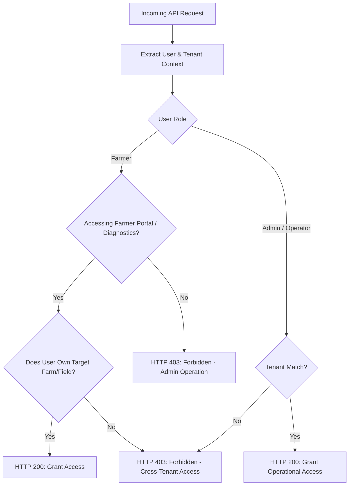

# AgriDrone AutoMap — Security & Access Requirements Specification

## 1. Security Architecture Principles

Security in AgriDrone AutoMap is engineered from the ground up to protect proprietary farm geographic boundaries, high-resolution aerial datasets, and agronomic business intelligence.

The architecture enforces five core security principles:
1. **Zero Client Trust**: All authorization decisions, tenancy checks, and file access validations occur strictly on the server.
2. **Principle of Least Privilege**: Azure Blob Storage containers are strictly private. No public anonymous read access is permitted.
3. **Short-Lived Ephemeral Delegation**: Direct browser downloads and tile streaming use signed, time-limited, narrowly-scoped Azure Shared Access Signatures (SAS).
4. **Tenant Isolation**: Agricultural data is partitioned by tenant. Cross-tenant reads or writes are blocked at the ORM/database query boundary.
5. **Defense in Depth**: Layered controls across transport encryption, HTTP headers, input sanitization, and structured audit trails.

---

## 2. Authentication (Open Decision Status)

> [!IMPORTANT]
> **Open Decision**: The final production authentication provider has not been selected.
> Potential architectural candidates:
> - **Option A**: Self-hosted OAuth2 / OpenID Connect with JWT access/refresh tokens in FastAPI.
> - **Option B**: Microsoft Entra ID (Azure AD / Azure AD B2C) integration, aligning natively with Azure cloud resources.
> - **Option C**: NextAuth / Auth.js integrating with a PostgreSQL session store.
> 
> *Requirement*: During Phase 1, no arbitrary authentication code or mock login flows are implemented. All subsequent specifications assume that an authenticated user context (User ID, Tenant ID, Roles) is delivered securely to the backend via an HTTP Authorization header.

---

## 3. Authorization & Role-Based Access Control (RBAC)

The system enforces strict separation of privileges between administrators/operators and farmers:

### Role Matrix:
| Operational Capability | Drone Operator / Admin | Farmer / Landowner |
| :--- | :---: | :---: |
| **Page 1: Ingest Drone Photos / GeoTIFFs** | Allowed | Denied (HTTP 403) |
| **Page 1: Create Farms & Field Boundaries** | Allowed | Denied (HTTP 403) |
| **Page 2: Configure & Trigger WebODM Jobs** | Allowed | Denied (HTTP 403) |
| **Page 2: Cancel / Restart WebODM Jobs** | Allowed | Denied (HTTP 403) |
| **Page 3: Assign Spectral Bands** | Allowed | Denied (HTTP 403) |
| **Page 3: Execute Vegetation Index Calculations**| Allowed | Denied (HTTP 403) |
| **Page 4: View Interactive Maps & Legends** | Allowed | Allowed (Owned Fields Only) |
| **Page 4: Download GeoTIFFs & PDF Reports** | Allowed | Allowed (Owned Fields Only) |
| **Page 5: Inspect Statistics & Zonal Charts** | Allowed | Allowed (Owned Fields Only) |
| **Page 5: Trigger PDF Report Compilation** | Allowed | Allowed (Owned Fields Only) |

---

## 4. Microsoft Azure Blob Storage Access Policies & SAS Token Security

- **Strictly Private Containers**:
  - The storage container (`agridrone-storage`) is configured with Public Access Level set to `Private` (no anonymous public access).
  - Storage account master access keys are strictly kept server-side in environment variables or Azure Key Vault and are **never transmitted to the frontend**.
- **Azure Managed Identity**:
  - In production Azure hosting environments, the FastAPI backend and Celery workers will authenticate to Azure Blob Storage using **Azure Managed Identities** (`DefaultAzureCredential`), eliminating stored credentials.
- **On-Demand Ephemeral SAS Generation**:
  - When an authorized user requests a file download (e.g., GeoTIFF or PDF report) or map tile range:
    1. FastAPI authenticates the user and verifies tenant ownership of the parent survey.
    2. FastAPI calls the Azure Storage SDK (`azure.storage.blob.generate_blob_sas`) using server-side credentials.
    3. The generated SAS token is configured with **Read-only permission (`read=True`)** and an expiration window of **15 minutes**.
    4. The frontend receives the signed URL and streams the asset directly from Azure Blob Storage.

---

## 5. Input Validation, Upload Security & Malicious File Mitigation

1. **File Extension & Magic Number Verification**:
   - Validation relies on binary magic bytes, not file extensions:
     - JPEG: `FF D8 FF`
     - TIFF / GeoTIFF / DNG: Little-endian `49 49 2A 00` or Big-endian `4D 4D 00 2A`
     - GeoJSON: Strict JSON parser parsing into a validated Shapely geometry.
2. **Path Traversal Prevention**:
   - User-supplied filenames are never used directly on the host filesystem.
   - Files are assigned random UUIDs upon ingestion and placed in deterministic storage paths:
     `{tenant_id}/{farm_id}/{survey_id}/{file_uuid}.{ext}`
   - All input paths are normalized and checked to prevent `../` directory traversal.
3. **Geometry Validation**:
   - Field boundaries uploaded via GeoJSON are validated using PostGIS `ST_IsValid` and `ST_MakeValid`. Invalid, self-intersecting, or non-polygon geometries are rejected.

---

## 6. Secrets Management & Environment Configuration

- **Zero Hardcoded Secrets**:
  - API keys, database credentials, Redis URLs, and Azure storage secrets must be loaded via environment variables using Pydantic Settings (`BaseSettings`).
  - `.env` files are strictly excluded from Git tracking via `.gitignore`.
- **Environment Matrix**:
  - `DATABASE_URL`: PostgreSQL connection string with password.
  - `REDIS_URL`: Redis broker connection string.
  - `AZURE_STORAGE_CONNECTION_STRING` or `AZURE_STORAGE_ACCOUNT_URL`: Azure endpoint.
  - `WEBODM_NODE_URL` & `WEBODM_NODE_TOKEN`: WebODM service credentials.
  - `SECRET_KEY`: Cryptographic signing key for sessions.

---

## 7. Logging Redaction & Audit Governance

- **Sensitive Data Redaction**:
  - Structured logging middleware scrubs query parameters, headers, and request bodies matching patterns: `password`, `token`, `secret`, `sig`, `key`, `authorization`.
  - SAS query parameters (e.g., `?sig=...`) are stripped from request log URLs.
- **Audit Logging**:
  - Critical actions are logged to a dedicated `audit_events` table in PostgreSQL:
    - User ID, Event Type (e.g., `SURVEY_INGEST`, `WEBODM_START`, `INDEX_GENERATE`, `REPORT_DOWNLOAD`), Target Resource UUID, Client IP Address, Timestamp.

---

## 8. Backup, Retention & Deletion Policies (Open Decisions)

- **Retention & Tiering**:
  - Raw aerial images (multi-gigabyte sets) can be transitioned to Azure Cool/Archive storage after 30-90 days to reduce storage costs **[Open Decision]**.
- **Data Deletion / GDPR**:
  - Soft-delete flags on PostgreSQL records (`is_deleted = TRUE`) with a background worker purging Azure blobs upon formal deletion confirmation.
