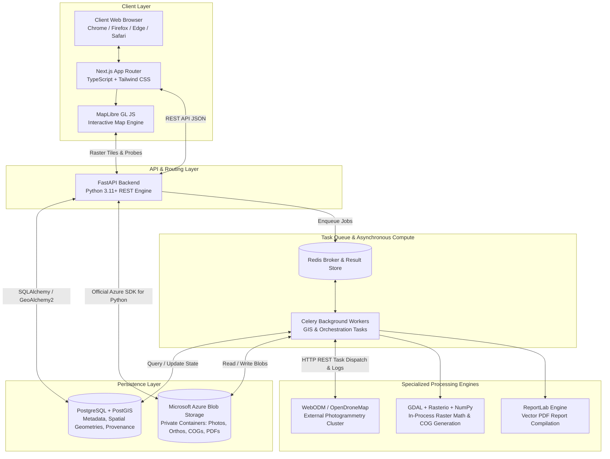
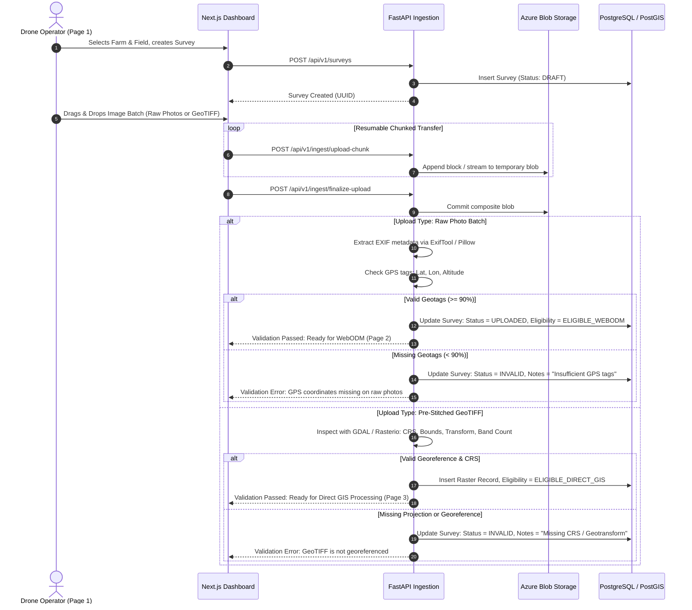
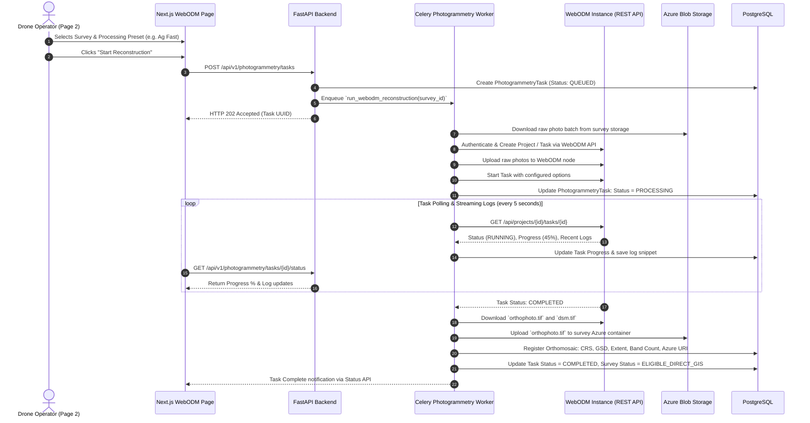
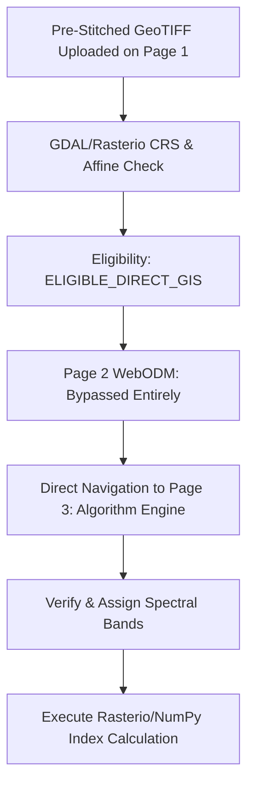
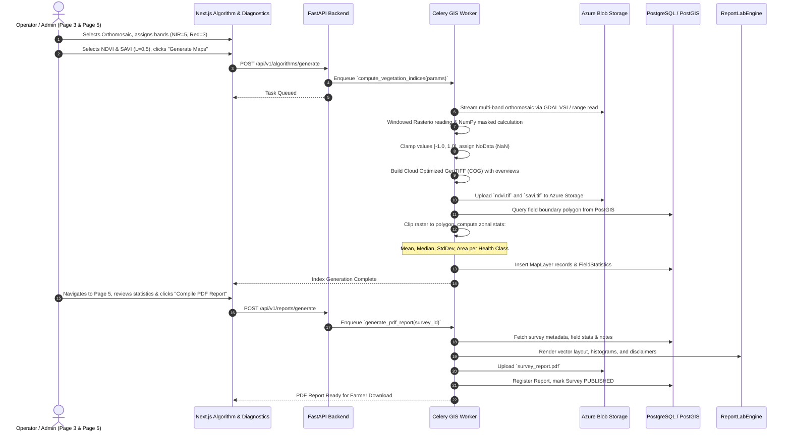

# AgriDrone AutoMap — System Workflow & Architecture Specification

## 1. Overall System Architecture

The AgriDrone AutoMap architecture is engineered as a decoupled, multi-tier system separating high-performance reactive web interfaces, fast asynchronous API routing, scalable task orchestration, specialized photogrammetric execution, and cloud object storage.

---

## 2. Component Responsibility Matrix

| Technology Component | Operational Role & Boundaries | What It Must NOT Do |
| :--- | :--- | :--- |
| **Next.js (App Router)** | Client-side UI rendering, form handling, state presentation, MapLibre container. | Must NOT connect directly to PostgreSQL or execute GIS processing. |
| **FastAPI** | Request authentication, input validation, CRUD endpoints, SAS token generation, Celery task dispatching. | Must NOT run blocking, heavy photogrammetry or full raster calculations synchronously. |
| **PostgreSQL + PostGIS** | Relational records (farms, surveys, users), spatial field boundaries (`ST_Polygon`), raster metadata, calculation provenance. | Must NOT store raw image binaries, large GeoTIFF rasters, or point clouds. |
| **Microsoft Azure Blob Storage** | Primary, authoritative object store for all binary assets: raw photos, orthomosaics, COG index layers, PDF reports. | Does NOT execute code or GIS processing; passive object storage only. |
| **Redis** | In-memory message broker for Celery task queues; transient task status caching. | Must NOT be used as the permanent system of record. |
| **Celery Workers** | Asynchronous worker processes executing long-running tasks: WebODM dispatch, Rasterio/NumPy index math, ReportLab PDF assembly. | Does NOT handle direct external HTTP requests from clients. |
| **WebODM / OpenDroneMap** | Specialized photogrammetric reconstruction (Structure-from-Motion, point cloud, meshing, orthorectification). | Does NOT perform vegetation index math or store farmer records. |
| **GDAL / Rasterio / NumPy** | Embedded Python libraries within Celery workers for windowed raster reading, band math (NDVI/NDRE), COG generation. | Used only within backend worker context; not run on web servers. |
| **MapLibre GL JS** | In-browser client GIS map viewer, layer switching, opacity, split comparison, and point probes. | Does NOT compute vegetation indices; renders pre-generated tiles/rasters. |
| **ReportLab** | Python PDF authoring toolkit inside Celery worker compiling tables, vector charts, and thumbnails into downloadable reports. | Does NOT generate maps; assembles pre-computed data and images into PDF. |

---

## 3. Workflow A: Drone Image Ingestion & Pre-Flight Validation

---

## 4. Workflow B: WebODM Photogrammetry Reconstruction

---

## 5. Workflow C: Direct Raster Processing (Bypassing WebODM)

*Architectural Principle*: Pre-stitched orthomosaics provided by third-party processing labs or existing farm archives **must never be submitted to WebODM**. They skip Page 2 entirely and proceed directly to Page 3.

---

## 6. Workflow D: GIS Vegetation Index Generation & Report Compilation

