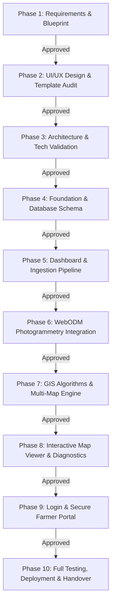

# AgriDrone AutoMap — Ten-Phase Project Roadmap

## 1. Overview & Phased Execution Strategy

AgriDrone AutoMap is delivered through an exact, sequential **Ten-Phase Engineering Roadmap**. Each phase constitutes a self-contained, auditable milestone with strict prerequisites, deliverables, and acceptance gates. 

No phase may commence until the preceding phase satisfies its exit criteria and receives formal stakeholder sign-off.

---

## 2. Phase 1 — Requirements and Project Blueprint (Current Phase)

- **Objective**: Establish the complete functional, technical, architectural, and security foundation of AgriDrone AutoMap across exactly five functional pages without writing application code.
- **Prerequisites**: Access to the project workspace and user project directives.
- **Tasks**:
  1. Inspect workspace to verify presence or absence of existing code, archives, or UI templates.
  2. Author comprehensive Phase 1 documentation suite in `docs/phase-1/`.
  3. Formulate strict five-page architecture, user journeys, and numbered functional requirements.
  4. Define GIS mathematical formulas, band prerequisites, and scientific validation rules.
  5. Specify Azure Blob Storage integration and security requirements.
  6. Document open architectural decisions without speculation.
  7. Update root `README.md`.
- **Expected Deliverables**:
  - `docs/phase-1/` containing 13 comprehensive markdown documents.
  - Updated root `README.md`.
- **Testing Requirements**:
  - Verification checklist evaluating all documents for internal consistency, presence of required sections, and compliance with the five-page limit.
- **Acceptance Criteria**:
  - All 13 documents created with rich technical depth.
  - Workspace condition and missing template status documented honestly.
  - Zero application code, migrations, or cloud resource provisioning introduced.
- **Dependencies**: None.
- **Risks**: Starting application implementation prematurely before requirements are approved.
- **Conditions Required Before Phase 2**: Stakeholder review and formal approval of Phase 1 blueprint; delivery of reference UI/UX template and screenshots.

---

## 3. Phase 2 — UI/UX Design Using the Supplied Template

- **Objective**: Analyze the supplied reference UI/UX template, extract reusable component layouts, and design screen mockups/wireframes for all five functional pages strictly following the reference authority.
- **Prerequisites**: Phase 1 sign-off; delivery of reference template source files, screenshots, and visual assets into the workspace.
- **Tasks**:
  1. Audit supplied template assets (HTML/React/Tailwind markup, CSS stylesheets, icons, design tokens).
  2. Map template components to the Five-Page architecture (Page 1 through Page 5).
  3. Design navigation, layout states (empty, loading, error, success), and modal dialogues.
  4. Establish theme tokens (typography, color palettes, spacing) aligned with the reference.
- **Expected Deliverables**:
  - UI/UX Design Specification (`docs/phase-2/ui-ux-specification.md`).
  - Component inventory catalog mapping template widgets to specific application screens.
- **Testing Requirements**:
  - Design review confirming visual alignment with reference screenshots.
  - Accessibility contrast verification for all text and UI elements.
- **Acceptance Criteria**:
  - All five pages mapped to existing template components without inventing novel design languages.
  - Zero extra main functional pages added.
- **Dependencies**: External delivery of reference template assets.
- **Risks**: Reference template assets missing or lacking required GIS/dashboard elements.
- **Conditions Required Before Phase 3**: Complete design blueprint approved by stakeholder.

---

## 4. Phase 3 — Architecture and Technical Validation

- **Objective**: Validate the core technical integrations (Docker Compose environment, FastAPI scaffold, WebODM REST client, Azure Blob Storage SDK, and GDAL/Rasterio) via isolated technical proofs-of-concept (PoCs).
- **Prerequisites**: Phase 2 approval; local Docker development environment.
- **Tasks**:
  1. Construct `docker-compose.yml` baseline defining PostgreSQL/PostGIS, Redis, WebODM node, FastAPI, and Next.js services.
  2. Validate Python GDAL/Rasterio bindings in the backend container.
  3. Validate Azure Blob Storage SDK connectivity and upload/download capability using test blobs.
  4. Validate WebODM REST API connectivity by polling node status.
- **Expected Deliverables**:
  - Technical Validation Report (`docs/phase-3/technical-validation-report.md`).
  - Working `docker-compose.yml` and container definitions.
- **Testing Requirements**:
  - Automated smoke test verifying container-to-container network communication.
  - Minimal script reading a test GeoTIFF with Rasterio and checking CRS/band count.
- **Acceptance Criteria**:
  - All approved stack technologies compile and communicate in Docker without version conflicts.
- **Dependencies**: Working Docker daemon.
- **Risks**: Native C-library compatibility issues with GDAL/PROJ inside Linux containers.
- **Conditions Required Before Phase 4**: Successful execution of all integration smoke tests.

---

## 5. Phase 4 — Project Foundation and Database

- **Objective**: Establish the production-grade project repository structure, configure PostgreSQL with PostGIS, author SQLAlchemy 2.0 ORM models, and implement Alembic migration scripts.
- **Prerequisites**: Phase 3 validation; agreed data model and open decisions resolved regarding authentication tenancy.
- **Tasks**:
  1. Initialize Next.js (TypeScript, Tailwind CSS) and FastAPI project scaffolding.
  2. Enable PostGIS extension in PostgreSQL.
  3. Create relational and spatial ORM models: `Tenants`, `Users`, `Farms`, `Fields` (with PostGIS polygon geometry), `Surveys`, `UploadedFiles`, `PhotogrammetryTasks`, `MapLayers`, `FieldStatistics`, `Reports`.
  4. Author initial Alembic migration script.
  5. Seed database with development test farm and boundary geometries.
- **Expected Deliverables**:
  - Backend and frontend folder scaffolding.
  - SQLAlchemy models (`backend/models/`) and Alembic migrations (`backend/alembic/`).
- **Testing Requirements**:
  - Database migration test: `alembic upgrade head` followed by `alembic downgrade base`.
  - Unit tests verifying spatial polygon insertion and bounding box queries via PostGIS.
- **Acceptance Criteria**:
  - Clean migration execution with zero schema errors.
- **Dependencies**: PostgreSQL + PostGIS container.
- **Risks**: Spatial geometry coordinate order mismatches (lat/lon vs lon/lat).
- **Conditions Required Before Phase 5**: Verified database schema and successful seed execution.

---

## 6. Phase 5 — Dashboard, Surveys, and Image Ingestion (Page 1)

- **Objective**: Implement Page 1 (Admin Dashboard & Drone Image Ingestion), enabling hierarchical entity creation, chunked file upload to Azure Blob Storage, and pre-flight metadata validation.
- **Prerequisites**: Phase 4 foundation; Azure Storage connection credentials.
- **Tasks**:
  1. Build Next.js Page 1 interface matching reference template: Farm/Field creator, dropzone, and eligibility ledger.
  2. Implement FastAPI chunked upload endpoint (`/api/v1/ingest/upload-chunk`).
  3. Integrate official Azure Storage SDK to stream blobs into private containers.
  4. Implement EXIF extraction service for raw photos and Rasterio inspection service for GeoTIFFs.
  5. Implement eligibility classifier tagging datasets as `ELIGIBLE_WEBODM` or `ELIGIBLE_DIRECT_GIS`.
- **Expected Deliverables**:
  - Functional Page 1 frontend and backend ingestion endpoints.
  - Ingestion service modules (`services/ingest/exif_service.py`, `services/ingest/raster_service.py`).
- **Testing Requirements**:
  - Unit tests for EXIF GPS extraction on sample geotagged photos.
  - Integration test uploading multi-part chunks and assembling composite blob in Azure Storage.
  - Validation test rejecting unprojected GeoTIFFs.
- **Acceptance Criteria**:
  - Upload ledger accurately displays upload progress and assigns correct eligibility badge.
- **Dependencies**: Azure Blob Storage account/emulator.
- **Risks**: Network dropouts during large multi-gigabyte uploads; mitigated via resumable chunking.
- **Conditions Required Before Phase 6**: Successful ingestion and validation of test photo batches and test GeoTIFFs.

---

## 7. Phase 6 — WebODM Photogrammetry Integration (Page 2)

- **Objective**: Implement Page 2 (WebODM Photogrammetry Processing), Celery task orchestration, asynchronous task dispatch to WebODM, live log streaming, and orthomosaic registration.
- **Prerequisites**: Phase 5 ingestion pipeline; reachable WebODM node instance.
- **Tasks**:
  1. Build Page 2 interface: Survey selector, photogrammetry presets, live progress bar, log terminal, and registration card.
  2. Author Celery task `run_webodm_reconstruction` managing project creation, image upload, and task execution via WebODM REST API.
  3. Implement polling worker forwarding real-time WebODM task logs to Redis pub/sub.
  4. Implement orthomosaic download and registration pipeline moving completed `orthophoto.tif` to Azure Storage and recording spatial metadata in PostGIS.
- **Expected Deliverables**:
  - Functional Page 2 frontend and photogrammetry worker module (`tasks/photogrammetry_tasks.py`).
  - WebODM API client wrapper (`services/photogrammetry/webodm_client.py`).
- **Testing Requirements**:
  - Mocked and live WebODM task submission test.
  - Resiliency test verifying worker handles WebODM node disconnect gracefully.
- **Acceptance Criteria**:
  - Completed WebODM runs automatically register a valid orthomosaic GeoTIFF in PostGIS and Azure.
- **Dependencies**: WebODM / OpenDroneMap compute instance.
- **Risks**: Photogrammetry execution duration and memory consumption; mitigated via dedicated queue and timeout monitors.
- **Conditions Required Before Phase 7**: Verified orthomosaic registered from a test raw flight.

---

## 8. Phase 7 — GIS Algorithms and Multi-Map Generation (Page 3)

- **Objective**: Implement Page 3 (Algorithm & Multi-Map Generation), band mapping grid, mathematical raster calculation engine (NDVI, NDRE, GNDVI, SAVI) using Rasterio and NumPy, and COG conversion.
- **Prerequisites**: Phase 5/6 delivering a registered multi-band orthomosaic in Azure Storage.
- **Tasks**:
  1. Build Page 3 interface: Orthomosaic selector, band verification grid, algorithm toggles, color-ramp selector, and layer ledger.
  2. Author Celery task `execute_vegetation_index_computation`.
  3. Implement windowed Rasterio calculation service executing NDVI, NDRE, GNDVI, and SAVI with numerical stability masking.
  4. Convert output floating-point rasters into Cloud Optimized GeoTIFFs (COGs) with internal overviews.
  5. Upload COGs to Azure Storage and register MapLayer records in PostgreSQL.
- **Expected Deliverables**:
  - Functional Page 3 frontend and GIS service modules (`services/gis/index_calculator.py`, `services/gis/cog_builder.py`).
- **Testing Requirements**:
  - Unit tests testing mathematical edge cases: denominator zero, negative reflectance, NoData clamping.
  - Scientific verification comparing calculated index arrays against reference GIS ground truth (QGIS benchmark).
  - Validation test confirming RGB imagery without NIR is strictly blocked.
- **Acceptance Criteria**:
  - Output COG rasters pass `rio cogeo validate` and match theoretical index equations.
- **Dependencies**: Rasterio, GDAL, and NumPy Python libraries.
- **Risks**: High memory usage on massive orthomosaics; mitigated via windowed block processing.
- **Conditions Required Before Phase 8**: Generated index COGs stored and queryable in Azure Storage.

---

## 9. Phase 8 — Interactive Maps and Diagnostics (Pages 4 & 5)

- **Objective**: Implement Page 4 (Secure Farmer Portal - Map Viewer) and Page 5 (Diagnostics & Actionable Insights), integrating MapLibre GL JS, raster tile serving, pixel probing, zonal statistics, and ReportLab PDF compilation.
- **Prerequisites**: Phase 7 generated COGs and MapLayer records.
- **Tasks**:
  1. Build Page 4 interface: MapLibre GL JS viewer, layer switcher, opacity slider, split comparison swipe, and dynamic legend.
  2. Implement COG tile serving endpoint in FastAPI or dynamic tile proxy.
  3. Implement pixel value probe endpoint (`/api/v1/map/probe?lat=...&lon=...`).
  4. Build Page 5 interface: Statistical summary cards, zonal vegetation breakdown charts, data limitations disclosures, and PDF generator card.
  5. Implement zonal statistics service clipping raster to PostGIS field boundary.
  6. Implement ReportLab PDF generator service compiling multi-page survey summary reports.
- **Expected Deliverables**:
  - Functional Page 4 and Page 5 frontend components.
  - Tile serving and statistics backend services (`services/gis/zonal_stats.py`, `services/reports/pdf_builder.py`).
- **Testing Requirements**:
  - MapLibre rendering test across desktop and tablet viewports.
  - Zonal statistics verification against manual polygon clip calculations.
  - PDF generation test verifying layout, metadata, charts, and legal disclaimers.
- **Acceptance Criteria**:
  - Map layers render smoothly; statistics reflect actual pixel counts; PDF generates cleanly without visual glitches.
- **Dependencies**: MapLibre GL JS, ReportLab.
- **Risks**: Tile rendering latency; mitigated via COG byte-range requests and Redis tile caching.
- **Conditions Required Before Phase 9**: Fully functional map visualization and PDF generation verified.

---

## 10. Phase 9 — Login and Secure Farmer Portal

- **Objective**: Implement the resolved authentication mechanism, enforce multi-tenant isolation across all endpoints, protect file downloads with short-lived Azure SAS URLs, and finalize the Farmer Portal role view.
- **Prerequisites**: Stakeholder resolution of Open Decision #1 (Authentication Provider); Phases 5–8 functional implementations.
- **Tasks**:
  1. Implement approved authentication entry gate (`/login`) and session/token validation middleware.
  2. Enforce tenancy verification dependencies across all FastAPI routes (`get_current_tenant`, `verify_farm_ownership`).
  3. Restrict farmer role strictly to Pages 4 and 5; return HTTP 403 on Pages 1, 2, and 3.
  4. Implement on-demand 15-minute Azure SAS generation endpoint for GeoTIFF and PDF downloads.
  5. Perform automated tenancy breach testing.
- **Expected Deliverables**:
  - Authentication middleware, route guards, and SAS token generation services.
- **Testing Requirements**:
  - Security suite attempting cross-tenant resource access (Tenant A accessing Tenant B's survey) expecting HTTP 403.
  - Farmer role permission test verifying administrative routes are blocked.
  - SAS expiration test verifying download link invalidation after 15 minutes.
- **Acceptance Criteria**:
  - Zero cross-tenant leakage; all direct asset downloads mediated via short-lived SAS links.
- **Dependencies**: Selected Auth Provider configuration.
- **Risks**: Authorization bypass vulnerabilities; mitigated via centralized dependency injection in FastAPI.
- **Conditions Required Before Phase 10**: Complete passing security test suite.

---

## 11. Phase 10 — Full Testing, Deployment, and Handover

- **Objective**: Execute end-to-end integration testing, performance benchmarking, container hardening, production deployment configuration, and produce administrator/farmer operational runbooks.
- **Prerequisites**: Phases 1–9 complete; target hosting infrastructure provisioned.
- **Tasks**:
  1. Author end-to-end automated test suite covering full user journeys (Ingest $\rightarrow$ WebODM $\rightarrow$ Index $\rightarrow$ View $\rightarrow$ Report).
  2. Perform load testing on upload pipeline and tile streaming.
  3. Produce production Docker Compose / Kubernetes deployment manifests.
  4. Write comprehensive System Administration Manual and Farmer User Guide.
  5. Conduct formal handover demonstration with stakeholders.
- **Expected Deliverables**:
  - End-to-end test suite (`tests/e2e/`).
  - Production deployment configuration and environment templates.
  - Handover documentation suite (`docs/handover/`).
- **Testing Requirements**:
  - 100% pass rate on end-to-end integration test suite.
  - Security scan (Bandit, Snyk, or Trivy) showing zero high/critical vulnerabilities.
- **Acceptance Criteria**:
  - Production deployment running successfully in target environment; formal stakeholder sign-off achieved.
- **Dependencies**: Target hosting infrastructure.
- **Risks**: Production environmental differences; mitigated via identical containerized staging environments.
- **Handover Completed**: Project transitions to operational maintenance.
