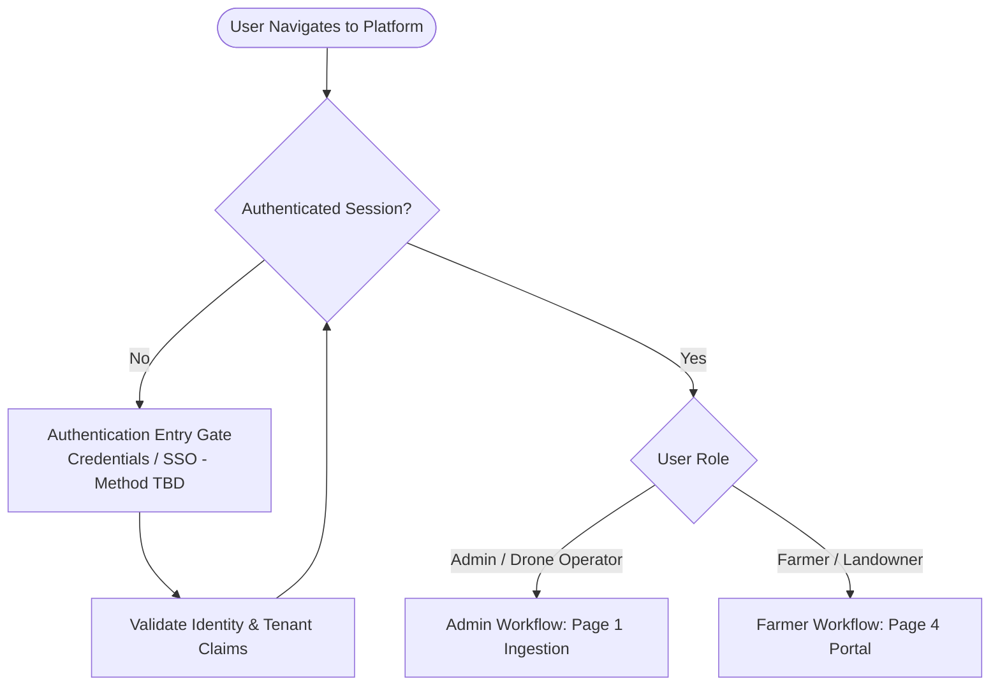
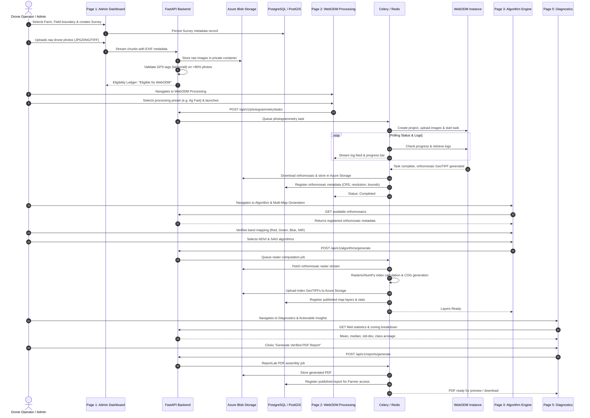
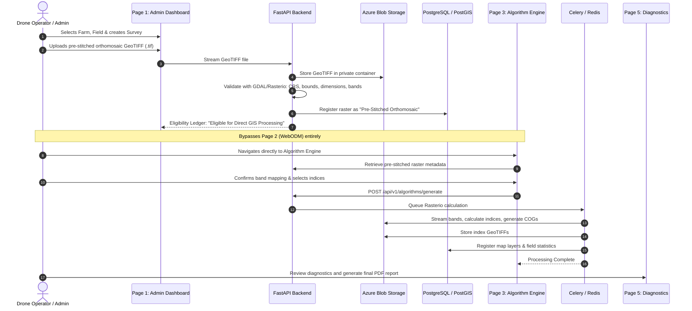
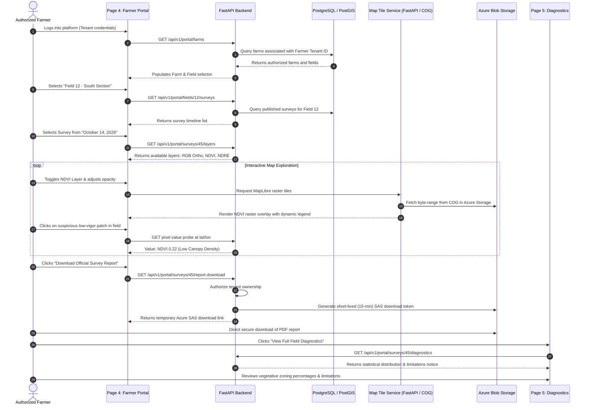

# AgriDrone AutoMap — User Journeys & End-to-End Workflows

## 1. Overview & System Persona Definition

This document details the step-by-step user journeys through the AgriDrone AutoMap platform. It maps out how different authorized personas interact with the system from initial login through data ingestion, photogrammetry, geospatial computation, visualization, and report generation.

### Personas Involved
1. **Agricultural Drone Operator / GIS Admin**: Responsible for flight creation, data uploading, photogrammetry execution, spectral algorithm calculation, and publishing.
2. **Authorized Farmer / Landowner**: Responsible for monitoring crop health on their owned fields, reviewing geospatial maps, inspecting diagnostics, and downloading final PDF reports.

---

## 2. Authentication Entry (Undecided Authentication Status)

> [!IMPORTANT]
> **Open Decision Status**: The exact technical authentication provider (e.g., custom OAuth2 with JWT, Azure Entra ID / Microsoft Identity, NextAuth / Auth.js with database sessions) remains an **unresolved decision** to be confirmed prior to Phase 4 / Phase 9 implementation.
> 
> The journeys below document the system flow assuming an authorized user has passed authentication and obtained a validated session token containing their tenant ID and role attributes.

---

## 3. Journey 1: Administrator End-to-End Drone Survey Processing Workflow

This is the primary operational workflow for drone technicians and system administrators.

### Detailed Steps:
1. **Survey Initiation**: Operator logs in, selects farm "GreenValley", field "Pivot-4", and inputs flight parameters (Date: 2026-10-14, Altitude: 80m, Sensor: MicaSense RedEdge-P).
2. **Raw Photo Ingestion**: Operator drags 350 geotagged TIFF files into the dropzone. System uploads chunks to Azure Blob Storage while FastAPI extracts EXIF data. Over 98% of photos contain valid GPS tags. The ledger marks the dataset *Eligible for WebODM*.
3. **Photogrammetry Execution**: Operator moves to Page 2, chooses "Ag Multispectral Precision" preset, and triggers reconstruction. Celery worker forwards files to the WebODM node. Operator watches the live OpenDroneMap log console as feature extraction, bundle adjustment, and orthophoto generation run. Upon completion, the multi-band orthomosaic is registered in PostGIS and archived in Azure.
4. **Spectral Index Generation**: Operator proceeds to Page 3. The system scans the orthomosaic and auto-identifies 5 spectral bands (Blue, Green, Red, RedEdge, NIR). The operator verifies band indices, checks NDVI and NDRE, selects the 5-class agronomic color palette, and triggers generation. Celery executes Rasterio/NumPy block calculations, generates Cloud Optimized GeoTIFFs, and registers the layers.
5. **Quality Review & Report Publishing**: Operator reviews statistical zoning on Page 5, notes that no cloud artifacts were present, triggers ReportLab PDF generation, and publishes the survey deliverables for farmer access.

---

## 4. Journey 2: Direct GIS Processing Workflow for Pre-Stitched GeoTIFFs

This workflow skips WebODM entirely for pre-stitched, georeferenced raster products (e.g., provided by specialized third-party processing labs or aerial contractors).

### Key Differences from Journey 1:
- Zero raw photo upload; single large GeoTIFF file upload.
- WebODM step is explicitly bypassed, saving substantial processing time and computing resources.
- Georeferencing, projection (CRS), and band structure must be validated on Page 1 before proceeding to Page 3.

---

## 5. Journey 3: Farmer / Landowner Geospatial Discovery & Review Workflow

This workflow represents the end-user experience for authorized farm owners and agronomists.

### Detailed Steps:
1. **Tenant-Filtered Access**: The farmer accesses the portal. The farm selector displays only the farms and fields owned by that farmer. Any attempt to query outside this tenancy returns an HTTP 403 Forbidden.
2. **Survey Timeline Selection**: Farmer picks a specific field and browses historical surveys to view seasonal crop development.
3. **Interactive Map Exploration**:
   - Farmer views the base satellite map overlaid with their field boundary polygon.
   - Activates the RGB True Color orthomosaic to inspect visual field anomalies (e.g., bare patches, standing water).
   - Switches to the NDVI layer. The MapLibre map renders the high-contrast agronomic color ramp with an interactive legend.
   - Uses the split-screen swipe tool to compare the visual RGB imagery directly against the NDVI vigor map.
4. **Secure Asset Download**: Farmer clicks the download button for the official survey report. The backend generates a secure, 15-minute SAS download link directly from Azure Blob Storage. The farmer downloads the PDF report without exposing internal storage keys.
5. **Deep Diagnostic Inspection**: Farmer transitions to Page 5 to inspect the area distribution breakdown (e.g., 72% High Vigor, 18% Moderate Vigor, 10% Stressed/Bare Ground) and reads the clear agronomic disclaimers regarding ground scouting.
