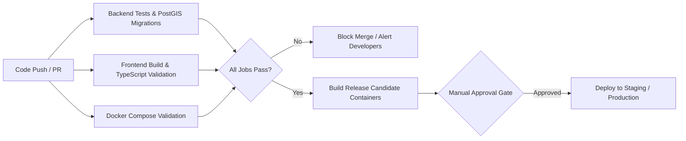

# CI/CD Pipeline & Production Release Standard

**Document:** Continuous Integration & Release Engineering Specification  
**Phase:** Phase 10  
**Status:** Approved  
**Date:** October 2026  

---

## 1. Overview & Pipeline Philosophy

AgriDrone AutoMap implements a secure, automated Continuous Integration and Continuous Deployment (CI/CD) pipeline via GitHub Actions (`.github/workflows/ci.yml`).

The release process is governed by three foundational rules:
1. **Zero Secrets in Code:** Workflow files declare zero hardcoded secrets. All credentials use GitHub Repository Secrets or OpenID Connect (OIDC) cloud federation.
2. **Hermetic Test Isolation:** Tests execute against real, ephemeral containerized instances of PostgreSQL 16 PostGIS and Redis 7.2.
3. **Manual Approval Gate for Production:** Merges to `main` validate tests and create container build artifacts, but **never execute automatic production migrations or public deployments without explicit manual release approval**.

---

## 2. Pipeline Stages & Verification Matrix

---

## 3. GitHub Actions Jobs Detailed

### 1. `backend-quality`
- **Runner:** `ubuntu-latest`
- **Services:** `postgis/postgis:16-3.4` (port 5434) and `redis:7.2-alpine` (port 6380).
- **Execution:**
  1. Installs OS geospatial libraries (`libpq-dev`, `libgeos-dev`).
  2. Installs pinned dependencies from `backend/requirements.txt`.
  3. Executes `alembic upgrade head` to verify that all migration revisions apply cleanly.
  4. Runs full pytest suite (`pytest -v`) verifying all 80 automated unit, API, and security tests.

### 2. `frontend-quality`
- **Runner:** `ubuntu-latest`
- **Node Version:** Node.js 20.x LTS.
- **Execution:**
  1. Installs npm packages via deterministic `npm ci`.
  2. Runs TypeScript strict compiler check (`npx tsc --noEmit`).
  3. Executes production build (`npm run build`) to ensure all 10 pages prerender and compile with zero errors.

### 3. `container-validation`
- **Runner:** `ubuntu-latest`
- **Execution:** Runs `docker compose -f docker-compose.yml config` and `docker compose -f docker-compose.prod.yml config` to catch syntax or port collision regressions.

---

## 4. Release Tagging & Semantic Versioning

Releases follow standard Semantic Versioning (`vMAJOR.MINOR.PATCH`):
- `v1.0.0-rc1`: Phase 10 Release Candidate 1 (Current baseline).
- `v1.0.0`: Production General Availability (GA) following final approval.

### Release Branching Workflow:
1. Feature development occurs on feature branches branched from `develop`.
2. PRs merged to `develop` trigger automated CI checks.
3. Release candidates branched to `release/v1.0.0`.
4. Final merge to `main` creates an immutable Git tag and release artifact.
