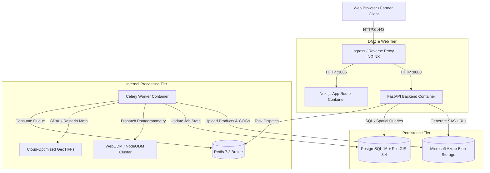

# Deployment Architecture & Container Orchestration

**Document:** Production Container Architecture Specification  
**Phase:** Phase 10  
**Status:** Approved  
**Date:** October 2026  

---

## 1. System Topology & Architecture Diagram

AgriDrone AutoMap enforces clear architectural service boundaries to isolate user-facing web requests from long-running GIS calculations and heavy photogrammetry pipelines:

---

## 2. Service Boundaries & Responsibilities

| Service | Technology | Primary Role | Ingress Exposure | Scaling Strategy |
| :--- | :--- | :--- | :---: | :--- |
| **`frontend`** | Next.js 14 + Tailwind | SSR, React components, MapLibre GL viewer | Public | Horizontal (Stateless, multi-pod) |
| **`backend`** | FastAPI + Python 3.11 | Authentication, CRUD, tile server, SAS links | Public | Horizontal (Stateless ASGI workers) |
| **`worker`** | Celery + Python 3.11 | Photogrammetry orchestration, raster math | Internal | Horizontal (Worker pool scaling) |
| **`db`** | PostgreSQL 16 + PostGIS | Relational schema, vector boundaries | Internal | Vertical + Read replicas |
| **`redis`** | Redis 7.2 | Message broker, cache, rate limiting | Internal | Standalone / Redis Sentinel |
| **`azure`** | Azure Blob Storage | Binary storage (GeoTIFFs, photos, PDFs) | Private (SAS only) | Cloud managed auto-scaling |

---

## 3. Container Security Hardening

In accordance with enterprise deployment standards:
1. **Non-Root Execution:** 
   - `backend/Dockerfile.prod` executes as `appuser` (UID 10001).
   - `frontend/Dockerfile.prod` executes as `nextjs` (UID 1001).
2. **Multi-Stage Optimization:**
   - Production images strip build tools (`build-essential`, `npm ci` caches) from runtime layers.
   - Reduces container attack surface and minimizes image transfer times.
3. **No Embedded Secrets:**
   - Docker images contain zero hardcoded API keys, database passwords, or JWT secrets.
   - All sensitive credentials are provided dynamically at container runtime via environment variables or secret mounts.
4. **Health Check Probes:**
   - All services define active health checks to support automatic container restarting and zero-downtime rolling updates.
