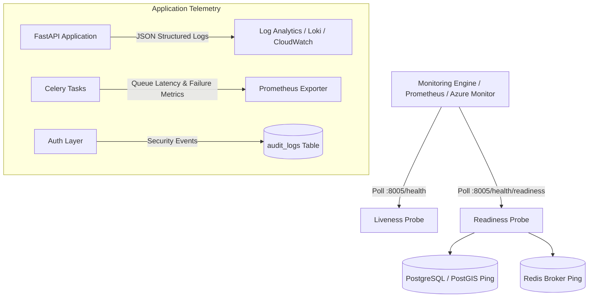

# Monitoring, Observability & Alerting Standard

**Document:** Operational Monitoring & Observability Specification  
**Phase:** Phase 10  
**Status:** Approved  
**Date:** October 2026  

---

## 1. Observability Architecture

AgriDrone AutoMap utilizes a multi-tiered monitoring approach covering process liveness, dependency health, background job queues, and security audit telemetry:



---

## 2. Health & Readiness Probes

### 1. Liveness Probe (`GET /api/v1/health`)
- **Purpose:** Verifies that the FastAPI process is running and accepting HTTP requests.
- **Payload:**
  ```json
  {
    "status": "ok",
    "version": "0.1.0",
    "environment": "production"
  }
  ```
- **Usage:** Container orchestrator restarts the container if liveness fails for 3 consecutive checks (interval: 10s).

### 2. Readiness Probe (`GET /api/v1/health/readiness`)
- **Purpose:** Validates active connectivity to both PostgreSQL (executes `SELECT PostGIS_Version();`) and Redis (sends `PING`).
- **Security:** Returns latency and component status without exposing database passwords, hostnames, or connection strings.
- **Payload:**
  ```json
  {
    "status": "ready",
    "components": {
      "database": {
        "status": "healthy",
        "latency_ms": 2.14,
        "details": "PostgreSQL with PostGIS 3.4"
      },
      "redis": {
        "status": "healthy",
        "latency_ms": 1.05,
        "details": "Redis broker responsive"
      }
    }
  }
  ```
- **Degraded State:** Returns `HTTP 503 Service Unavailable` if either service is unreachable, automatically removing the instance from the ingress traffic pool.

---

## 3. Recommended Operational Alert Thresholds

| Metric | Warning Threshold | Critical Threshold | Action Required |
| :--- | :--- | :--- | :--- |
| **API Error Rate (5xx)** | > 2% of requests for 5 min | > 5% of requests for 2 min | Inspect application traceback logs for unhandled exceptions. |
| **API Response Time (p95)**| > 1,500 ms for 5 min | > 3,500 ms for 2 min | Inspect database query latency or raster file I/O bottlenecks. |
| **Database Connectivity** | Latency > 100 ms | Connection timeout (5s) | Check database CPU, memory, and connection pool utilization. |
| **Redis Queue Backlog** | > 10 queued jobs | > 30 queued jobs | Scale up Celery worker replicas (`docker compose up --scale worker=3`). |
| **Disk Storage (NVMe/SSD)**| > 75% capacity | > 90% capacity | Purge temporary photogrammetry scratch files; check container logs. |
| **Auth Failure Spike** | > 10 failed logins / min | > 50 failed logins / min | Trigger IP rate limiting; inspect `/audit_logs` for brute force attempts. |

---

## 4. Structured Application Logging

The FastAPI backend uses `python-json-logger` to output machine-parsable JSON lines in production:

```json
{
  "timestamp": "2026-10-15T12:00:00.123Z",
  "level": "INFO",
  "logger": "app.api.v1.endpoints.auth",
  "message": "User login successful",
  "user_id": "b2f69e6b-1934-4b45-8bc6-94301d6706e5",
  "ip_address": "192.168.1.100",
  "action": "LOGIN_SUCCESS"
}
```

- **Sensitive Data Redaction:** Passwords, JWT secrets, authorization headers, and raw Azure SAS tokens are strictly masked prior to log serialization.
