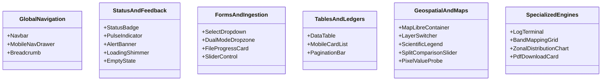

# AgriDrone AutoMap — Component Inventory & Reuse Catalog

## 1. Overview & Architectural Component Registry

This inventory details all reusable frontend components designed for AgriDrone AutoMap. Every component is engineered to adhere to the reference template's styling tokens, support responsive viewports, and provide predictable accessibility attributes.



---

## 2. Component Inventory Matrix

| Component Name | Category | Primary Function | Consuming Pages |
| :--- | :--- | :--- | :--- |
| **`Navbar`** | Navigation | Sticky top header with brand mark, route links, NodeODM status pill, and user profile. | All Pages (1, 2, 3, 4, 5) |
| **`MobileNavDrawer`** | Navigation | Slide-over drawer providing touch-friendly vertical navigation on viewports $<768\text{ px}$. | All Pages (1, 2, 3, 4, 5) |
| **`BreadcrumbHeader`** | Navigation | Contextual page title, ancestor hierarchy trail, and primary action button. | All Pages (1, 2, 3, 4, 5) |
| **`StatusBadge`** | Status | Pill container rendering color-coded state (`done`, `processing`, `queued`, `failed`, `uploading`). | Page 1, Page 2, Page 3, Page 4 |
| **`PulseIndicator`** | Status | Small pulsing circle indicating live background service connectivity (e.g. NodeODM Online). | Navbar, Page 2 |
| **`AlertBanner`** | Feedback | Contextual notice box (`info`, `warning`, `error`, `success`) with iconography and action links. | All Pages (1, 2, 3, 4, 5) |
| **`EmptyState`** | Feedback | Centered icon, heading, descriptive copy, and primary action button for unpopulated views. | All Pages (1, 2, 3, 4, 5) |
| **`LoadingShimmer`** | Feedback | Animated skeleton shimmer placeholder for asynchronous data loading. | All Pages (1, 2, 3, 4, 5) |
| **`DualModeDropzone`** | Ingestion | Drag-and-drop file target with mode toggle (Raw Photos vs Pre-Stitched GeoTIFF) and progress bars. | Page 1 |
| **`PreFlightValidationCard`** | Ingestion | Real-time display of extracted CRS, GSD, band count, and EXIF geotag percentage. | Page 1 |
| **`DatasetLedgerTable`** | Data Table | Structured table displaying ingested surveys, file counts, sizes, status, and routing buttons. | Page 1 |
| **`PhotogrammetryPresetSelector`**| Processing | Radio card cluster selecting WebODM options (Fast Ag, Precision, Custom) with parameter sliders.| Page 2 |
| **`TaskExecutionCard`** | Processing | Live task card showing active WebODM stage, progress percentage, and cancellation control. | Page 2 |
| **`LogTerminal`** | Processing | Monospace auto-scrolling terminal window displaying real-time WebODM task logs. | Page 2 |
| **`BandMappingGrid`** | GIS Analytics | Interactive table mapping detected raster bands to physical spectral roles (Red, Green, NIR, etc.). | Page 3 |
| **`AlgorithmGatingMatrix`** | GIS Analytics | Selection matrix enabling/disabling NDVI, NDRE, GNDVI, and SAVI based on band verification. | Page 3 |
| **`ColorRampSelector`** | GIS Analytics | Dropdown selecting color palettes (RdYlGn, Viridis) with min/max clamp sliders. | Page 3, Page 4 |
| **`MapLibreContainer`** | Geospatial | Interactive MapLibre GL JS canvas with tile overlays, vector field boundaries, and zoom controls. | Page 4 |
| **`LayerSwitcher`** | Geospatial | Radio / checkbox toggles for active map layers with continuous opacity sliders ($0-100\%$). | Page 4 |
| **`SplitComparisonSlider`** | Geospatial | Draggable vertical divider enabling side-by-side visual comparison of RGB Ortho vs. NDVI. | Page 4 |
| **`ScientificLegend`** | Geospatial | Color ramp legend displaying numerical value ranges and qualitative vegetation health classes. | Page 4 |
| **`PixelValueProbe`** | Geospatial | Interactive map anchor popup displaying clicked coordinates and exact measured index value. | Page 4 |
| **`MetricSummaryCard`** | Analytics | High-emphasis numerical metric card (Mean, Median, StdDev, Hectares) with trend subtitle. | Page 5 |
| **`ZonalDistributionChart`** | Analytics | Horizontal stacked bar and tabular breakdown of area/percentage per vegetation health bracket. | Page 5 |
| **`LimitationsDisclosureBox`** | Analytics | Prominent callout box stating sensor calibration mode and mandatory agronomic disclaimers. | Page 5 |
| **`PdfDownloadCard`** | Reports | Configuration and compilation card for official ReportLab PDF reports with download links. | Page 4, Page 5 |

---

## 3. Deep Component Specifications & Interfaces

### A. `StatusBadge` Component
```typescript
interface StatusBadgeProps {
  status: "DONE" | "PROCESSING" | "QUEUED" | "FAILED" | "UPLOADING" | string;
  size?: "sm" | "md";
  className?: string;
}
```
- **Behavior**: Normalizes string status to uppercase, renders corresponding semantic pill styling (`badge-done`, `badge-processing`, etc.), and embeds Lucide glyph (`CheckCircle2`, `Loader2 animate-spin`, `Clock`, `AlertCircle`, `UploadCloud`).

### B. `DualModeDropzone` Component
```typescript
interface DualModeDropzoneProps {
  mode: "raw_photos" | "geotiff";
  onModeChange: (mode: "raw_photos" | "geotiff") => void;
  onFilesSelected: (files: File[]) => void;
  isUploading: boolean;
  uploadProgress: number;
  acceptedExtensions: string[];
}
```
- **Behavior**: Handles HTML5 drag-and-drop events, displays visual drop feedback, filters files by extension (`.jpg`, `.dng`, `.tif`, `.tiff`), and provides whole-folder selection buttons.

### C. `BandMappingGrid` Component
```typescript
interface BandMapping {
  bandIndex: number;
  detectedName: string;
  wavelengthNm?: number;
  assignedRole: "blue" | "green" | "red" | "red_edge" | "nir" | "thermal" | "unassigned";
}

interface BandMappingGridProps {
  bands: BandMapping[];
  onRoleChange: (bandIndex: number, role: BandMapping["assignedRole"]) => void;
  isReadOnly?: boolean;
}
```
- **Behavior**: Renders raster channels; flags conflicts if the same role is assigned to multiple bands; dynamically calculates which vegetation index algorithms are eligible.

### D. `ScientificLegend` Component
```typescript
interface LegendBracket {
  color: string;
  label: string;
  min: number;
  max: number;
  areaHectares?: number;
  percentage?: number;
}

interface ScientificLegendProps {
  indexName: "NDVI" | "NDRE" | "GNDVI" | "SAVI";
  palette: "rdylgn" | "viridis";
  brackets: LegendBracket[];
  clampedRange: [number, number];
}
```
- **Behavior**: Renders floating translucent panel on map canvas; visualizes color ramp gradient with minimum and maximum numerical ticks and qualitative health category swatches.
