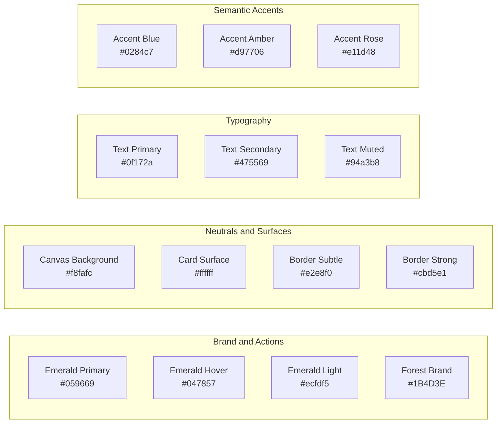

# AgriDrone AutoMap — Design System Specification

## 1. Design System Philosophy & Core Foundations

The AgriDrone AutoMap Design System is derived directly from the user's reference template (`drone-main` and `dron`). It prioritizes:
1. **Agricultural Functional Clarity**: High-contrast, clean surfaces allowing complex aerial rasters, false-color vegetation maps, and data tables to take center stage without visual clutter.
2. **Visual Continuity**: 100% adherence to the reference template's emerald, slate, and white color hierarchy, 12px rounded cards, and pill status badges.
3. **Accessibility & Rigor**: Minimum WCAG 2.1 AA contrast ratios ($\ge 4.5:1$ for text) and legible typography across desktop and mobile devices.

---

## 2. Color Tokens & Semantic Usage



### Complete Palette Reference:
| Category | Token Name | Value | Purpose & Interface Location | Contrast Ratio on White |
| :--- | :--- | :--- | :--- | :---: |
| **Primary Brand** | `color-primary` | `#059669` | Primary buttons, active nav icons, brand mark, key metrics | $4.55:1$ (AA) |
| **Primary Hover** | `color-primary-hover` | `#047857` | Button hover state, active focus outlines | $6.02:1$ (AAA) |
| **Primary Light** | `color-primary-light` | `#ecfdf5` | Badges, success callouts, table highlight fills | Background surface |
| **Forest Brand** | `color-brand-dark` | `#1B4D3E` | Dark hero cards, header accents, brand logomarks | $10.45:1$ (AAA) |
| **Surfaces** | `color-bg-canvas` | `#f8fafc` | Page body background (Slate 50) | Background surface |
| **Surfaces** | `color-bg-card` | `#ffffff` | Primary card panels, modal dialogues, input fields | Background surface |
| **Borders** | `color-border-subtle` | `#e2e8f0` | Standard card borders, table row dividers (Slate 200) | Structural divider |
| **Borders** | `color-border-strong` | `#cbd5e1` | Input field borders, inactive tab borders (Slate 300) | Form boundary |
| **Text** | `color-text-primary` | `#0f172a` | Page titles, table headers, high-emphasis values | $16.12:1$ (AAA) |
| **Text** | `color-text-secondary`| `#475569` | Body paragraphs, form labels, tooltips | $7.28:1$ (AAA) |
| **Text** | `color-text-muted` | `#94a3b8` | Metadata, timestamps, placeholders | $2.55:1$ (Non-body) |
| **Informational** | `color-accent-blue` | `#0284c7` | WebODM processing states, informational banners | $4.62:1$ (AA) |
| **Warning** | `color-accent-amber`| `#d97706` | Ingestion warnings, missing GPS flags, soil factor alerts| $4.52:1$ (AA) |
| **Error / Danger** | `color-accent-rose` | `#e11d48` | Failed tasks, missing spectral bands, deletion actions | $4.68:1$ (AA) |

---

## 3. Typography Scale & Hierarchy

- **Font Family**: `-apple-system, BlinkMacSystemFont, "Segoe UI", Roboto, Helvetica, Arial, sans-serif`
- **Monospace Stack**: `ui-monospace, SFMono-Regular, Menlo, Monaco, Consolas, "Liberation Mono", "Courier New", monospace`

| Type Role | Tailwind Class | Font Size / Line Height | Font Weight | Letter Spacing |
| :--- | :--- | :--- | :---: | :---: |
| **Page Header** | `text-2xl` | $24\text{ px} / 32\text{ px}$ | 700 (Bold) | `-0.025em` |
| **Section Header** | `text-lg` | $18\text{ px} / 28\text{ px}$ | 600 (Semibold) | `-0.015em` |
| **Card Title** | `text-sm` | $14\text{ px} / 20\text{ px}$ | 600 (Semibold) | Normal |
| **Body Default** | `text-sm` | $14\text{ px} / 20\text{ px}$ | 400 (Regular) | Normal |
| **Form Label** | `text-xs` | $12\text{ px} / 16\text{ px}$ | 600 (Semibold) | Normal |
| **Badge / Tag** | `text-xs` | $12\text{ px} / 16\text{ px}$ | 600 (Semibold) | Normal |
| **Micro Caption** | `text-[11px]` | $11\text{ px} / 14\text{ px}$ | 500 (Medium) | `+0.05em` (Uppercase) |
| **Terminal / Code** | `text-xs font-mono`| $12\text{ px} / 18\text{ px}$ | 400 (Regular) | Normal |

---

## 4. Spacing, Borders & Corner Radii

### A. Spacing Scale
- Primary Page Padding: `px-4 sm:px-6 lg:px-8 py-6`
- Card Internal Padding: `p-5` ($20\text{ px}$) or `p-6` ($24\text{ px}$)
- Stack Gaps: `space-y-6` ($24\text{ px}$) between major sections; `space-y-4` ($16\text{ px}$) within cards
- Component Element Gaps: `gap-2` ($8\text{ px}$) for button icons; `gap-3` ($12\text{ px}$) for badge clusters

### B. Corner Radii Tokens
- **Small (`rounded-md`)**: $6\text{ px}$ — Dropdown items, tooltips.
- **Medium (`rounded-lg`)**: $8\text{ px}$ — Buttons, input fields, select menus, icon boxes (`w-9 h-9`).
- **Large (`rounded-xl`)**: $12\text{ px}$ — Primary cards, panels, dropzones, modal dialogues.
- **Full (`rounded-full`)**: $9999\text{ px}$ — Status badges, avatar pills, active pulse dots.

### C. Shadows
- **Card Default**: `box-shadow: 0 1px 3px 0 rgba(0, 0, 0, 0.04), 0 1px 2px -1px rgba(0, 0, 0, 0.02);`
- **Elevated / Hover**: `box-shadow: 0 4px 6px -1px rgba(0, 0, 0, 0.05), 0 2px 4px -2px rgba(0, 0, 0, 0.03);`
- **Modal Backdrop**: `box-shadow: 0 20px 25px -5px rgba(0, 0, 0, 0.1), 0 8px 10px -6px rgba(0, 0, 0, 0.1);`

---

## 5. Reusable Component Styles

### A. Buttons
```html
<!-- Primary Button -->
<button class="inline-flex items-center justify-center gap-2 bg-emerald-600 hover:bg-emerald-700 text-white font-medium px-4 py-2 rounded-lg text-sm transition-colors shadow-sm">
  <UploadCloud class="w-4 h-4" />
  <span>Upload Drone Files</span>
</button>

<!-- Secondary Button -->
<button class="inline-flex items-center justify-center gap-2 bg-white hover:bg-slate-50 text-slate-700 border border-slate-200 font-medium px-4 py-2 rounded-lg text-sm transition-colors">
  <Sliders class="w-4 h-4 text-slate-500" />
  <span>Configure Options</span>
</button>

<!-- Destructive Button -->
<button class="inline-flex items-center justify-center gap-2 bg-white hover:bg-rose-50 text-rose-600 border border-rose-200 font-medium px-4 py-2 rounded-lg text-sm transition-colors">
  <XCircle class="w-4 h-4 text-rose-500" />
  <span>Cancel Task</span>
</button>
```

### B. Form Inputs & Select Controls
```html
<!-- Text / Number Input -->
<div class="space-y-1.5">
  <label class="text-xs font-semibold text-slate-700 uppercase tracking-wider">Flight Altitude (meters)</label>
  <input type="number" class="w-full bg-white border border-slate-300 rounded-lg px-3 py-2 text-sm text-slate-900 placeholder:text-slate-400 focus:outline-none focus:border-emerald-600 focus:ring-2 focus:ring-emerald-500/20 transition-all" placeholder="e.g. 80" />
</div>
```

### C. Status Badges & Indicators
All badges follow the reference template's pill container with an accompanying Lucide glyph:
- **Completed / Ready**: `bg-emerald-50 text-emerald-700 border border-emerald-200` + `CheckCircle2`
- **Processing / Active**: `bg-blue-50 text-blue-700 border border-blue-200` + `Loader2 animate-spin`
- **Queued / Scheduled**: `bg-slate-50 text-slate-600 border border-slate-200` + `Clock`
- **Failed / Corrupt**: `bg-rose-50 text-rose-700 border border-rose-200` + `AlertCircle`
- **Uploading / Ingesting**: `bg-amber-50 text-amber-700 border border-amber-200` + `UploadCloud`
- **Live Node Pulsing Dot**: `<span class="w-2 h-2 rounded-full bg-emerald-500 pulse-active" />`

### D. Table Standards
- Container: `border border-slate-200 rounded-xl overflow-hidden bg-white shadow-sm`
- Header: `bg-slate-50/80 border-b border-slate-200 px-4 py-3 text-left text-xs font-semibold text-slate-600 uppercase tracking-wider`
- Row: `border-b border-slate-100 hover:bg-slate-50/50 transition-colors px-4 py-3 text-sm text-slate-700`
- Pagination: Bottom bar with record count and clean previous/next buttons.

---

## 6. Scientific GIS Legends & Map Styling

Map overlays adhere to standard scientific remote sensing color ramps:
1. **5-Class Agronomic Palette (RdYlGn)**:
   - High Canopy Vigour ($> 0.65$): Deep Emerald (`#1b5e20`)
   - Moderate Canopy ($0.45 - 0.65$): Light Leaf Green (`#4caf50`)
   - Transitional Canopy ($0.30 - 0.45$): Warm Yellow (`#ffeb3b`)
   - Sparse / Stressed Vegetation ($0.15 - 0.30$): Amber Orange (`#ff9800`)
   - Bare Soil / Water ($< 0.15$): Dark Terracotta / Red (`#d32f2f`)
2. **Legend Display Widget**:
   - Anchored in the bottom-right or top-left of the MapLibre canvas.
   - White frosted glass background (`bg-white/95 backdrop-blur-sm border border-slate-200 rounded-lg p-3 shadow-md`).
   - Color gradient bar paired with minimum, mid, and maximum numerical value ticks.
   - Categorical swatch list with acreage / hectare breakdowns.

---

## 7. Mandatory UI States

Every screen and functional component implements five explicit visual states:

| UI State | Visual Representation & Components Used |
| :--- | :--- |
| **1. Empty State** | Centered illustration/icon (`FolderSearch` or `Sprout` in `text-slate-300`), heading (`text-base font-semibold text-slate-800`), descriptive helper paragraph (`text-sm text-slate-500 max-w-sm mx-auto`), and primary call-to-action button. |
| **2. Loading State** | Skeleton shimmer placeholders matching card/table layouts, accompanied by spinning `Loader2` and progress bar with percentage indicator. |
| **3. Success State** | Emerald banner (`bg-emerald-50 border-emerald-200 text-emerald-800 rounded-lg p-4`), clear confirmation checkmark, and a direct primary action button to advance to the next workflow stage. |
| **4. Warning State** | Amber banner (`bg-amber-50 border-amber-200 text-amber-800 rounded-lg p-4`) highlighting non-blocking anomalies (e.g. "12 photos lack EXIF GPS tags; 96% geotagged threshold met"). |
| **5. Error State** | Rose banner (`bg-rose-50 border-rose-200 text-rose-800 rounded-lg p-4`) detailing exact failure reason (e.g. "NIR band missing. NDVI cannot be computed on 3-band RGB imagery.") with actionable "Retry" or "Reassign Bands" button. |
