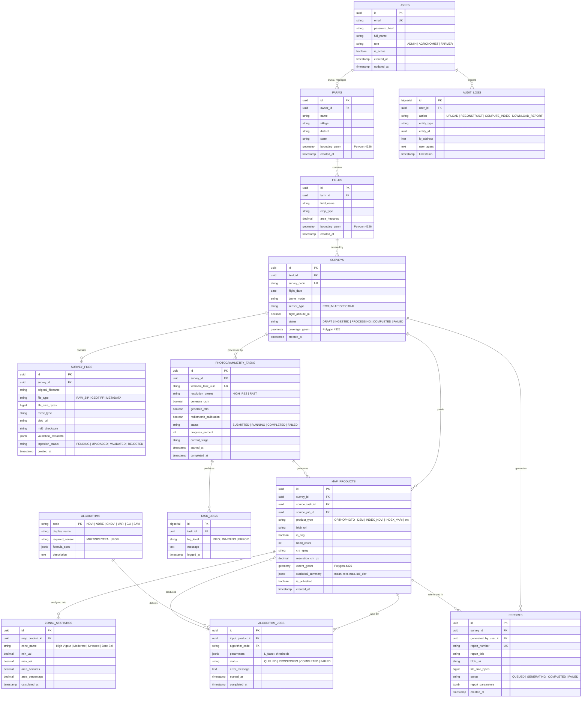

# AgriDrone AutoMap — Database Architecture & Data Model
## Document Reference: `docs/phase-3/database-and-data-model.md`
**Phase**: Phase 3 — System Architecture, Technical Validation & Implementation Blueprint  
**Status**: APPROVED ARCHITECTURE BLUEPRINT  
**Version**: 1.0.0  

---

## 1. Database Philosophy & Technology Selection

The AgriDrone AutoMap persistence layer is built on **PostgreSQL 15+** with the **PostGIS 3.3+** spatial extension.

### Core Database Rules:
1. **No Binary Blob Storage in Database**: Large raster binaries (GeoTIFFs, COGs, point cloud LAS files, raw photo ZIPs) are strictly stored in Microsoft Azure Blob Storage. PostgreSQL stores structured metadata, spatial footprints, file sizes, checksums, and Azure blob URIs.
2. **Spatial Geometry as First-Class Data**: All farm boundaries, field perimeters, flight coverage extents, and orthomosaic footprints are stored as genuine PostGIS vector geometries (`GEOMETRY(Polygon, 4326)`), indexed with spatial GIST indexes.
3. **Multi-Tenant Ownership & Isolation**: Every field, survey, file, task, and map product has an explicit foreign-key path back to a `farm_id` and `user_id`. Queries in the farmer portal strictly scope access by verifying ownership.
4. **Auditable State Transitions**: All background processing tasks, photogrammetry attempts, and algorithm executions maintain immutable status ledgers with timestamps, error messages, and execution durations.

---

## 2. Entity Relationship Diagram (ERD)

---

## 3. Detailed Table Specifications & Constraints

### 3.1. `users` Table
Stores authenticated platform identities and system roles.
- `id`: `UUID`, Primary Key, default `gen_random_uuid()`.
- `email`: `VARCHAR(255)`, Unique, Not Null, Index.
- `password_hash`: `VARCHAR(255)`, Not Null (Argon2 / Bcrypt hash).
- `full_name`: `VARCHAR(150)`, Not Null.
- `role`: `VARCHAR(30)`, Not Null, Check Constraint: `role IN ('ADMIN', 'AGRONOMIST', 'FARMER')`.
- `is_active`: `BOOLEAN`, Default `TRUE`, Not Null.
- `created_at`: `TIMESTAMPTZ`, Default `NOW()`, Not Null.

### 3.2. `farms` Table
Represents an agricultural holding or enterprise.
- `id`: `UUID`, Primary Key.
- `owner_id`: `UUID`, Foreign Key $\to$ `users(id)`, On Delete Restrict, Not Null.
- `name`: `VARCHAR(200)`, Not Null.
- `village`: `VARCHAR(100)`, Nullable.
- `district`: `VARCHAR(100)`, Nullable.
- `state`: `VARCHAR(100)`, Nullable.
- `boundary_geom`: `GEOMETRY(Polygon, 4326)`, Nullable, Spatial Index.
- `created_at`: `TIMESTAMPTZ`, Default `NOW()`, Not Null.

### 3.3. `fields` Table
Represents a discrete agricultural parcel or management zone within a farm.
- `id`: `UUID`, Primary Key.
- `farm_id`: `UUID`, Foreign Key $\to$ `farms(id)`, On Delete Cascade, Not Null.
- `field_name`: `VARCHAR(150)`, Not Null.
- `crop_type`: `VARCHAR(100)`, Nullable.
- `area_hectares`: `NUMERIC(10, 4)`, Computed from boundary or entered manually.
- `boundary_geom`: `GEOMETRY(Polygon, 4326)`, Not Null, Spatial Index.

### 3.4. `surveys` Table
Represents a specific aerial flight survey conducted over a field.
- `id`: `UUID`, Primary Key.
- `field_id`: `UUID`, Foreign Key $\to$ `fields(id)`, On Delete Cascade, Not Null.
- `survey_code`: `VARCHAR(50)`, Unique, Not Null (e.g., `SRV-2026-BAR-001`).
- `flight_date`: `DATE`, Not Null.
- `drone_model`: `VARCHAR(100)`, Nullable.
- `sensor_type`: `VARCHAR(50)`, Not Null, Check: `sensor_type IN ('RGB', 'MULTISPECTRAL')`.
- `flight_altitude_m`: `NUMERIC(6, 2)`, Nullable.
- `status`: `VARCHAR(30)`, Not Null, Default `'DRAFT'`, Check: `status IN ('DRAFT', 'INGESTED', 'PROCESSING', 'COMPLETED', 'FAILED')`.
- `coverage_geom`: `GEOMETRY(Polygon, 4326)`, Nullable, Spatial Index.

### 3.5. `survey_files` Table (Page 1)
Maintains the registry of raw uploaded archives, images, and pre-stitched GeoTIFFs.
- `id`: `UUID`, Primary Key.
- `survey_id`: `UUID`, Foreign Key $\to$ `surveys(id)`, On Delete Cascade, Not Null.
- `original_filename`: `VARCHAR(255)`, Not Null.
- `file_type`: `VARCHAR(50)`, Not Null, Check: `file_type IN ('RAW_ZIP', 'GEOTIFF', 'METADATA')`.
- `file_size_bytes`: `BIGINT`, Not Null.
- `mime_type`: `VARCHAR(100)`, Not Null.
- `blob_uri`: `VARCHAR(500)`, Not Null (Azure storage path).
- `md5_checksum`: `VARCHAR(32)`, Nullable.
- `validation_metadata`: `JSONB`, Nullable (stores EXIF count, geotransform, CRS, resolution).
- `ingestion_status`: `VARCHAR(30)`, Not Null, Default `'PENDING'`, Check: `ingestion_status IN ('PENDING', 'UPLOADED', 'VALIDATED', 'REJECTED')`.

### 3.6. `photogrammetry_tasks` & `task_logs` Tables (Page 2)
Tracks WebODM 3D reconstruction and orthomosaic generation jobs.
- `id`: `UUID`, Primary Key.
- `survey_id`: `UUID`, Foreign Key $\to$ `surveys(id)`, On Delete Cascade, Not Null.
- `webodm_task_uuid`: `VARCHAR(64)`, Unique, Nullable.
- `resolution_preset`: `VARCHAR(30)`, Default `'HIGH_RES'`.
- `generate_dsm`: `BOOLEAN`, Default `TRUE`.
- `generate_dtm`: `BOOLEAN`, Default `TRUE`.
- `radiometric_calibration`: `BOOLEAN`, Default `FALSE`.
- `status`: `VARCHAR(30)`, Not Null, Default `'SUBMITTED'`, Check: `status IN ('SUBMITTED', 'DISPATCHING', 'RUNNING', 'COMPLETED', 'FAILED')`.
- `progress_percent`: `INTEGER`, Default `0`, Check: `progress_percent BETWEEN 0 AND 100`.
- `current_stage`: `VARCHAR(100)`, Nullable (e.g. `'Point Cloud Densification'`).
- `started_at`: `TIMESTAMPTZ`, Nullable.
- `completed_at`: `TIMESTAMPTZ`, Nullable.

### 3.7. `map_products` Table (Pages 2, 3, 4)
The authoritative catalog of all raster products (Orthomosaics, DSMs, COG index layers).
- `id`: `UUID`, Primary Key.
- `survey_id`: `UUID`, Foreign Key $\to$ `surveys(id)`, On Delete Cascade, Not Null.
- `source_task_id`: `UUID`, Foreign Key $\to$ `photogrammetry_tasks(id)`, Nullable.
- `source_job_id`: `UUID`, Foreign Key $\to$ `algorithm_jobs(id)`, Nullable.
- `product_type`: `VARCHAR(50)`, Not Null, Check: `product_type IN ('ORTHOPHOTO', 'DSM', 'DTM', 'INDEX_NDVI', 'INDEX_NDRE', 'INDEX_GNDVI', 'INDEX_VARI', 'INDEX_GLI', 'INDEX_SAVI')`.
- `blob_uri`: `VARCHAR(500)`, Not Null.
- `is_cog`: `BOOLEAN`, Default `TRUE` (Must be Cloud-Optimized GeoTIFF).
- `band_count`: `INTEGER`, Not Null.
- `crs_epsg`: `VARCHAR(20)`, Not Null (e.g. `'EPSG:32643'`).
- `resolution_cm_px`: `NUMERIC(8, 2)`, Nullable.
- `extent_geom`: `GEOMETRY(Polygon, 4326)`, Not Null, Spatial Index.
- `statistical_summary`: `JSONB`, Nullable (stores `{min: -0.2, max: 0.85, mean: 0.48, std_dev: 0.14}`).
- `is_published`: `BOOLEAN`, Default `FALSE` (Governs visibility in Farmer Portal).

### 3.8. `algorithm_jobs` Table (Page 3)
Tracks vegetation index calculations executed by Celery workers via GDAL/Rasterio/NumPy.
- `id`: `UUID`, Primary Key.
- `input_product_id`: `UUID`, Foreign Key $\to$ `map_products(id)`, On Delete Restrict, Not Null.
- `algorithm_code`: `VARCHAR(30)`, Foreign Key $\to$ `algorithms(code)`, Not Null.
- `parameters`: `JSONB`, Nullable (e.g. `{"L_factor": 0.5}`).
- `status`: `VARCHAR(30)`, Not Null, Default `'QUEUED'`, Check: `status IN ('QUEUED', 'PROCESSING', 'COMPLETED', 'FAILED')`.
- `error_message`: `TEXT`, Nullable.

### 3.9. `reports` Table (Page 5)
Maintains compiled agronomic PDF reports generated by ReportLab.
- `id`: `UUID`, Primary Key.
- `survey_id`: `UUID`, Foreign Key $\to$ `surveys(id)`, On Delete Cascade, Not Null.
- `generated_by_user_id`: `UUID`, Foreign Key $\to$ `users(id)`, Not Null.
- `report_number`: `VARCHAR(50)`, Unique, Not Null (e.g. `RPT-2026-10-0012`).
- `report_title`: `VARCHAR(200)`, Not Null.
- `blob_uri`: `VARCHAR(500)`, Not Null.
- `file_size_bytes`: `BIGINT`, Not Null.
- `status`: `VARCHAR(30)`, Not Null, Check: `status IN ('QUEUED', 'GENERATING', 'COMPLETED', 'FAILED')`.
- `report_parameters`: `JSONB`, Nullable.

---

## 4. Indexing Strategy

To ensure high performance across complex multi-tenant filters and spatial queries:
1. **Spatial Indexes (GIST)**:
   - `CREATE INDEX idx_fields_boundary_geom ON fields USING GIST (boundary_geom);`
   - `CREATE INDEX idx_surveys_coverage_geom ON surveys USING GIST (coverage_geom);`
   - `CREATE INDEX idx_map_products_extent_geom ON map_products USING GIST (extent_geom);`
2. **Foreign Key & Tenant B-Tree Indexes**:
   - `CREATE INDEX idx_farms_owner_id ON farms (owner_id);`
   - `CREATE INDEX idx_fields_farm_id ON fields (farm_id);`
   - `CREATE INDEX idx_surveys_field_id ON surveys (field_id);`
   - `CREATE INDEX idx_survey_files_survey_id ON survey_files (survey_id);`
   - `CREATE INDEX idx_map_products_survey_id ON map_products (survey_id);`
   - `CREATE INDEX idx_reports_survey_id ON reports (survey_id);`
3. **Compound Status & Lifecycle Indexes**:
   - `CREATE INDEX idx_tasks_survey_status ON photogrammetry_tasks (survey_id, status);`
   - `CREATE INDEX idx_algo_jobs_status ON algorithm_jobs (status);`
   - `CREATE INDEX idx_products_published ON map_products (survey_id, is_published);`

---

## 5. Database Migration Strategy (Alembic)

Database schema evolution is managed through **Alembic**:
1. All migrations are tracked in `backend/alembic/versions/` with sequential revision IDs.
2. The initial migration `0001_initial_schema.py` enables PostGIS (`CREATE EXTENSION IF NOT EXISTS postgis;`) and sets up all core tables, constraints, and GIST indexes.
3. Migrations are executed automatically in container entrypoints during staging/production deployment via `alembic upgrade head`.
4. Downward migrations (`downgrade()`) are mandatory for every revision to support rollback.
