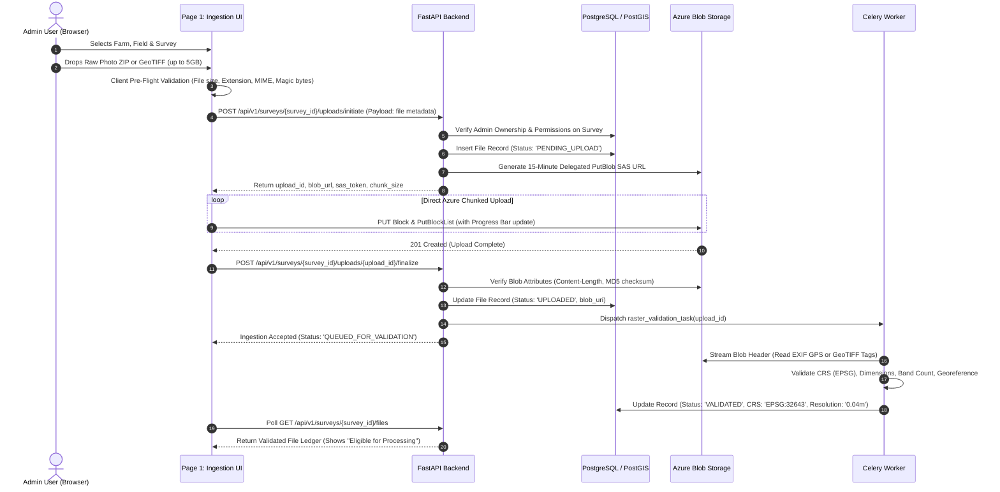
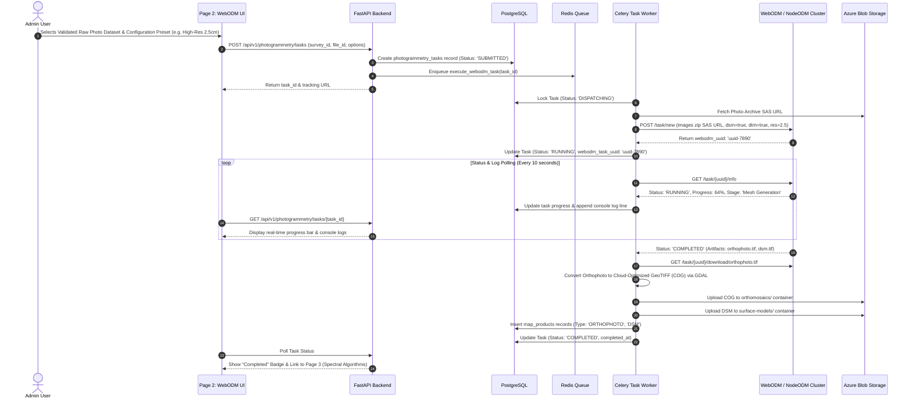
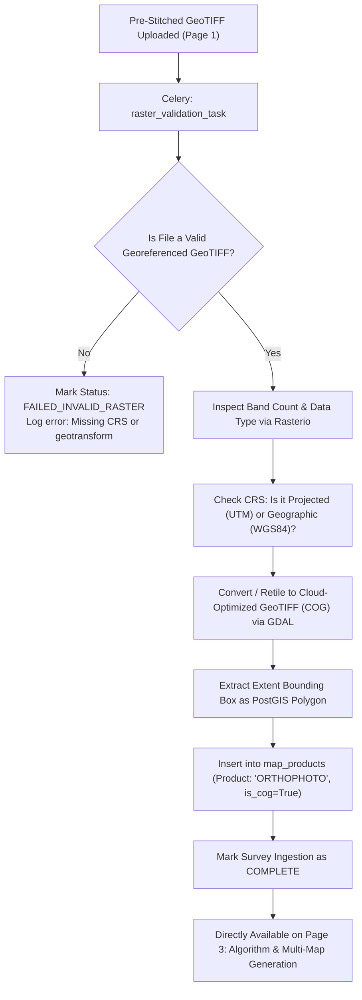
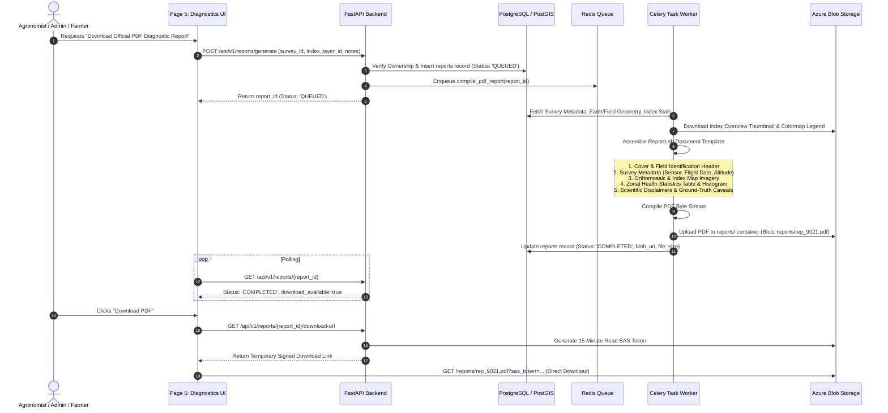
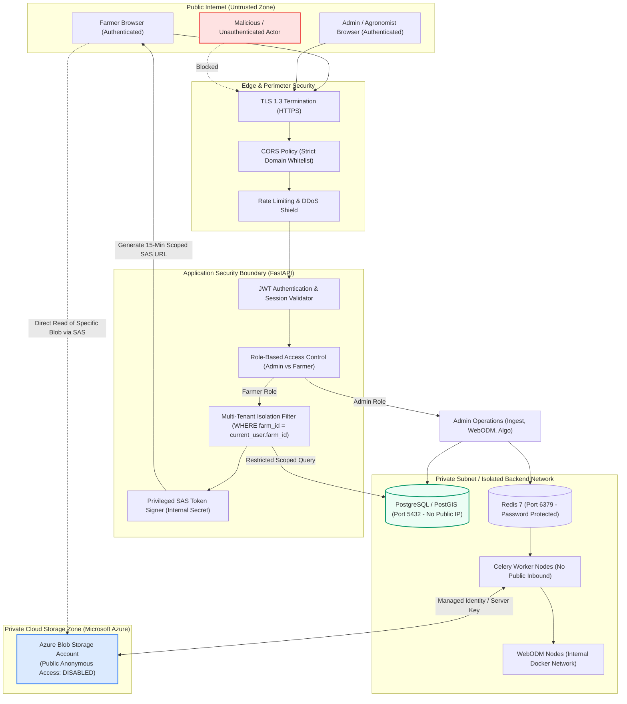

# AgriDrone AutoMap — System Architecture Diagrams
## Document Reference: `docs/phase-3/system-architecture-diagrams.md`
**Phase**: Phase 3 — System Architecture, Technical Validation & Implementation Blueprint  
**Status**: APPROVED ARCHITECTURE BLUEPRINT  
**Version**: 1.0.0  

---

## 1. High-Level System Architecture Diagram

This diagram illustrates the relationship and communication protocols between the Presentation Layer, Application Layer, Asynchronous Processing Tier, Database, and Cloud Storage.

```mermaid
graph TB
    subgraph ClientLayer ["Client Presentation Tier (Next.js 14 App Router)"]
        UI_Ingest["Page 1: Ingestion & Validation"]
        UI_WebODM["Page 2: WebODM Photogrammetry"]
        UI_Algo["Page 3: Spectral Algorithms"]
        UI_Portal["Page 4: Farmer Portal (MapLibre GL)"]
        UI_Diag["Page 5: Diagnostics & Reports"]
    end

    subgraph GatewayLayer ["API & Gateway Tier (FastAPI)"]
        API_Router["FastAPI Core Router (/api/v1)"]
        Auth_Guard["Auth & Tenant Authorization Middleware"]
        SAS_Service["Azure SAS Token Service"]
        Task_Dispatcher["Celery Task Dispatcher"]
    end

    subgraph StorageLayer ["Cloud Storage Tier (Microsoft Azure)"]
        Azure_Raw["raw-surveys container"]
        Azure_Ortho["orthomosaics container"]
        Azure_Indices["vegetation-indices container"]
        Azure_Reports["reports container"]
    end

    subgraph DatabaseLayer ["Persistence Tier (PostgreSQL 15 + PostGIS 3.3)"]
        DB_Meta["Relational Tables (Farms, Fields, Surveys)"]
        DB_Geo["Spatial Vector Geometries (Boundaries, EPSG:4326)"]
        DB_Jobs["Task Execution Ledger & Audit Logs"]
    end

    subgraph AsyncTier ["Asynchronous Compute Tier (Celery & Redis)"]
        Redis_Broker["Redis 7 (Message Broker & Result Backend)"]
        Worker_Raster["Worker: Raster Validation & GDAL COG Tiler"]
        Worker_Algo["Worker: Spectral Index Computation (NumPy/Rasterio)"]
        Worker_Stats["Worker: Zonal Statistics & Agronomic Metrics"]
        Worker_PDF["Worker: ReportLab PDF Compilation"]
    end

    subgraph PhotogrammetryCluster ["Photogrammetry Processing Cluster"]
        NodeODM_Mgr["WebODM / NodeODM Orchestrator"]
        NodeODM_Worker1["NodeODM Processing Node 1"]
        NodeODM_Worker2["NodeODM Processing Node 2"]
    end

    %% Client to API
    UI_Ingest -->|HTTPS REST| API_Router
    UI_WebODM -->|HTTPS REST| API_Router
    UI_Algo -->|HTTPS REST| API_Router
    UI_Portal -->|HTTPS REST / Vector GeoJSON| API_Router
    UI_Diag -->|HTTPS REST| API_Router

    %% Direct SAS Upload / Download
    UI_Ingest -.->|Direct Chunked Upload via SAS| Azure_Raw
    UI_Portal -.->|Tile Range Requests via SAS| Azure_Indices
    UI_Diag -.->|Direct PDF Download via SAS| Azure_Reports

    %% Gateway Internal Flow
    API_Router --> Auth_Guard
    Auth_Guard --> DB_Meta
    Auth_Guard --> SAS_Service
    SAS_Service --> Azure_Raw
    API_Router --> Task_Dispatcher
    Task_Dispatcher --> Redis_Broker

    %% Async Execution
    Redis_Broker --> Worker_Raster
    Redis_Broker --> Worker_Algo
    Redis_Broker --> Worker_Stats
    Redis_Broker --> Worker_PDF

    %% Worker Data Access
    Worker_Raster <-->|Read Raw / Write COG| Azure_Ortho
    Worker_Raster -->|Update Status| DB_Jobs
    Worker_Algo <-->|Read Ortho / Write Index COG| Azure_Indices
    Worker_Algo -->|Update Status| DB_Jobs
    Worker_Stats -->|Query Boundary| DB_Geo
    Worker_Stats -->|Save Metrics| DB_Meta
    Worker_PDF -->|Read Index & Stats / Write PDF| Azure_Reports
    Worker_PDF -->|Save Report Record| DB_Meta

    %% WebODM Integration
    Task_Dispatcher -->|HTTP Dispatch| NodeODM_Mgr
    NodeODM_Mgr --> NodeODM_Worker1
    NodeODM_Mgr --> NodeODM_Worker2
    NodeODM_Worker1 <-->|Read Photos / Write Ortho & DSM| Azure_Ortho
    NodeODM_Mgr -->|Task Status Polling| DB_Jobs
```



---

## 2. Upload & Pre-Flight Ingestion Workflow (Page 1)

This sequence details how client files (drone image archives or pre-stitched GeoTIFFs) are validated, staged via Azure Blob SAS tokens, and registered into the PostgreSQL database.



---

## 3. WebODM Photogrammetry Processing Workflow (Page 2)

This workflow applies strictly to **Workflow 1: Raw Drone Photographs** that require 3D structure-from-motion reconstruction, point cloud generation, and digital elevation modeling.



---

## 4. Direct Pre-Stitched Raster Processing Workflow (Page 1 $\to$ Page 3)

This workflow applies strictly to **Workflow 2: Pre-Stitched GeoTIFFs** (e.g., orthomosaics generated externally by Pix4D, DJI Terra, or Agisoft Metashape). It bypasses WebODM entirely.



---

## 5. Spectral Algorithm & Multi-Map Generation Workflow (Page 3)

This workflow governs spectral band mapping, scientific guardrail validation, and calculation of vegetation indices (NDVI, NDRE, GNDVI, VARI, GLI, SAVI).

```mermaid
sequenceDiagram
    autonumber
    actor Admin as Admin User
    participant UI as Page 3: Algorithms UI
    participant API as FastAPI Backend
    participant DB as PostgreSQL
    participant Redis as Redis Queue
    participant Worker as Celery Task Worker
    participant Azure as Azure Blob Storage

    Admin->>UI: Selects Orthophoto Product
    UI->>API: GET /api/v1/algorithms/inspect-bands?product_id=prod-101
    API->>DB: Fetch Product Metadata (Bands: 3, Names: [Red, Green, Blue])
    API-->>UI: Return Band Profile (RGB Detected, NIR Absent)
    
    UI->>UI: Apply Scientific Gating: Lock NDVI & NDRE; Enable VARI, GLI, TGI
    Admin->>UI: Selects VARI Index & Color Palette ('RdYlGn')
    Admin->>UI: Clicks "Generate Multi-Map Layer"
    
    UI->>API: POST /api/v1/algorithms/jobs (product_id, algorithm: 'VARI', colormap: 'RdYlGn')
    API->>DB: Insert algorithm_jobs record (Status: 'QUEUED')
    API->>Redis: Enqueue compute_vegetation_index(job_id)
    API-->>UI: Return job_id (Status: 'QUEUED')

    Worker->>DB: Update Job (Status: 'PROCESSING')
    Worker->>Azure: Stream Orthophoto Windows via GDAL/Rasterio
    Worker->>Worker: Read Band 1 (Red), Band 2 (Green), Band 3 (Blue)
    Worker->>Worker: Apply Floating-Point Raster Math:<br/>VARI = (Green - Red) / (Green + Red - Blue)<br/>Mask DivByZero & NoData
    Worker->>Worker: Compress & Tile into Cloud-Optimized GeoTIFF (COG)
    Worker->>Azure: Upload COG to vegetation-indices/ container
    Worker->>Worker: Compute Basic Histogram & Mean/Median/StdDev
    Worker->>DB: Insert map_products record (Type: 'INDEX_VARI', Path, Stats)
    Worker->>DB: Update Job (Status: 'COMPLETED')
    
    UI->>API: Poll GET /api/v1/algorithms/jobs/{job_id}
    API-->>UI: Return Completed (Show Preview & Action to Publish to Farmer Portal)
```

---

## 6. Report Generation Workflow (Page 5)

This sequence details how validated statistical distributions, metadata, and maps are compiled into a durable PDF report via ReportLab.



---

## 7. Security & Authorization Boundaries

This diagram illustrates trust boundaries, network zones, and data access isolation across User Roles (Admin, Agronomist, Farmer).


