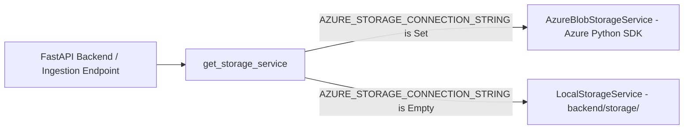

# AgriDrone AutoMap — Azure Blob Storage Integration & Setup
## Document Reference: `docs/phase-5/azure-blob-storage-setup.md`
**Phase**: Phase 5 — Admin Dashboard, Farm/Survey Management & Drone Image Ingestion  
**Status**: APPROVED STORAGE SPECIFICATION  
**Version**: 1.0.0  

---

## 1. Storage Architecture Overview

AgriDrone AutoMap utilizes **Microsoft Azure Blob Storage** as its official object storage provider for high-volume aerial drone photography, photogrammetric orthomosaics, and vegetation index rasters.

To ensure frictionless local development and automated testing without incurring cloud costs or requiring active cloud credentials, the system implements a strict **Storage Abstraction Service** (`app.services.storage.BaseStorageService`).

---

## 2. Configuration Parameters

The following environment variables configure storage access in `backend/.env`:

| Variable Name | Default Value | Description |
| :--- | :--- | :--- |
| **`AZURE_STORAGE_CONNECTION_STRING`** | *(empty)* | Full connection string for Azure Storage Account. If empty, local adapter is used. |
| **`AZURE_STORAGE_ACCOUNT_NAME`** | `agridronestorage` | Target Azure Storage Account name |
| **`AZURE_CONTAINER_RAW`** | `raw-surveys` | Container for raw drone photographs & incoming GeoTIFFs |
| **`AZURE_CONTAINER_ORTHO`** | `orthomosaics` | Container for WebODM-generated orthomosaic rasters |
| **`AZURE_CONTAINER_INDICES`** | `vegetation-indices`| Container for calculated spectral indices (NDVI, NDRE) |
| **`AZURE_CONTAINER_REPORTS`** | `reports` | Container for compiled PDF agronomic reports |
| **`LOCAL_STORAGE_PATH`** | `storage` | Relative directory path for local fallback storage |
| **`ALLOW_DEV_LOCAL_STORAGE`** | `true` | Allows local file storage fallback in development |

---

## 3. Production Azure Setup Guide

When provisioning production Azure resources (Phase 10):
1. **Create Storage Account**:
   - Redundancy: Standard LRS or GRS.
   - Access Tier: Hot.
   - Hierarchical Namespace: Disabled (standard blob).
2. **Configure Private Containers**:
   Create the four dedicated containers with **Private (no anonymous access)** permissions:
   - `raw-surveys`
   - `orthomosaics`
   - `vegetation-indices`
   - `reports`
3. **Secure Access with SAS Tokens**:
   Public read access is never enabled. For authorized browser map rendering and report downloads, the backend generates short-lived, narrowly scoped Shared Access Signatures (`generate_blob_sas`) with 60-minute expiry.

---

## 4. Local Development Fallback Behavior

When `AZURE_STORAGE_CONNECTION_STRING` is unconfigured:
1. The backend automatically initializes `LocalStorageService`.
2. Uploads are stored in `backend/storage/{container}/{survey_id}/{safe_filename}`.
3. Path traversal attacks (e.g. `../../etc/passwd`) are strictly neutralized by `_resolve_safe_path()` using `os.path.abspath` boundary checks.
4. The API exposes `local_dev` in dashboard telemetry, maintaining complete transparency about where files reside.
