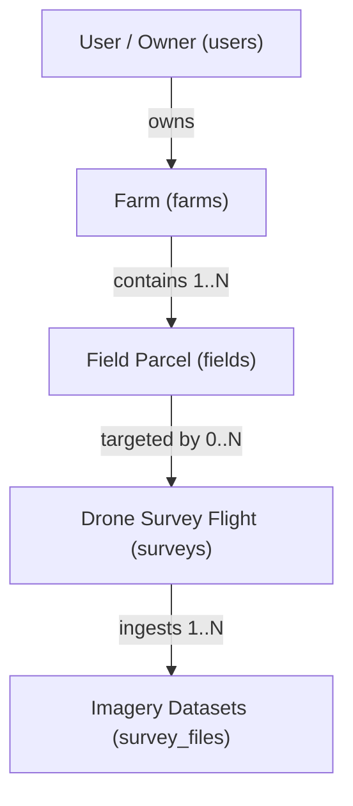

# AgriDrone AutoMap — Farm & Field Management Guide
## Document Reference: `docs/phase-5/farm-field-management.md`
**Phase**: Phase 5 — Admin Dashboard, Farm/Survey Management & Drone Image Ingestion  
**Status**: APPROVED DESIGN & IMPLEMENTATION  
**Version**: 1.0.0  

---

## 1. Domain Model & Spatial Hierarchy

AgriDrone AutoMap structures agricultural land into a strict three-tier hierarchy:
1. **User / Tenant**: The agricultural enterprise or farm owner.
2. **Farm**: The contiguous agricultural holding, estate, or station (e.g. "Baramati Precision Farm").
3. **Field**: Discrete cultivation parcels or pivots with specific crops and planting seasons (e.g. "Sugarcane North Block 1").

All coordinates and boundaries are managed in **WGS84 (EPSG:4326)** via PostGIS geometries.

---

## 2. Capabilities Implemented

### 2.1. Farm Operations
- **List Farms**: `GET /api/v1/farms`
  - Pagination (`skip`, `limit`).
  - Search filter querying farm name, village, district, or state.
  - Dynamically calculates associated field and survey counts using SQL aggregates.
- **Register Farm**: `POST /api/v1/farms`
  - Required field: `name` (1–200 characters).
  - Optional metadata: `village`, `district`, `state`.
  - Optional spatial boundary: `boundary_geojson` (validated as a PostGIS `POLYGON` in EPSG:4326).
  - Boundary is not mandatory at initial registration, supporting workflows where field surveys precede boundary digitizing.
- **Get Farm Details**: `GET /api/v1/farms/{farm_id}`
  - Returns complete metadata, serialized GeoJSON boundary, and a list of all child fields.
- **Update Farm**: `PUT /api/v1/farms/{farm_id}`
  - Modifies permitted metadata and updates or replaces polygon boundaries.
- **Delete Farm**: `DELETE /api/v1/farms/{farm_id}`
  - Cascades deletion to child fields, surveys, and associated file metadata.

### 2.2. Field Operations
- **List Fields for Farm**: `GET /api/v1/farms/{farm_id}/fields`
  - Returns child fields ordered by creation date.
- **Create Field Parcel**: `POST /api/v1/farms/{farm_id}/fields`
  - Enforces parent farm existence (returns HTTP 404 if parent does not exist).
  - Required: `field_name` (1–150 characters).
  - Optional: `crop_type`, `area_hectares` (0.01 to 100,000 ha), `boundary_geojson`.
- **Field Detail & Update**: `GET /api/v1/fields/{field_id}`, `PUT /api/v1/fields/{field_id}`
- **Delete Field**: `DELETE /api/v1/fields/{field_id}`
  - Cascades to associated survey missions.

---

## 3. PostGIS Spatial Validation Rules

All submitted GeoJSON boundaries pass through `validate_and_convert_geojson_polygon()`:
1. **Geometry Type**: Must be a `Polygon`. Points, LineStrings, or MultiPolygons are rejected with HTTP 422.
2. **Topological Validity**: Verified using Shapely `geom.is_valid`. Self-intersecting rings attempt an automated `buffer(0)` repair. If invalid, rejected with HTTP 422.
3. **Coordinate Reference Bounds**: Coordinates must strictly lie within WGS84 geographical bounds:
   $$\text{Longitude} \in [-180.0, 180.0], \quad \text{Latitude} \in [-90.0, 90.0]$$
4. **Storage Format**: Stored as a PostGIS binary geometry column with explicit SRID: `GEOMETRY(POLYGON, 4326)`.
