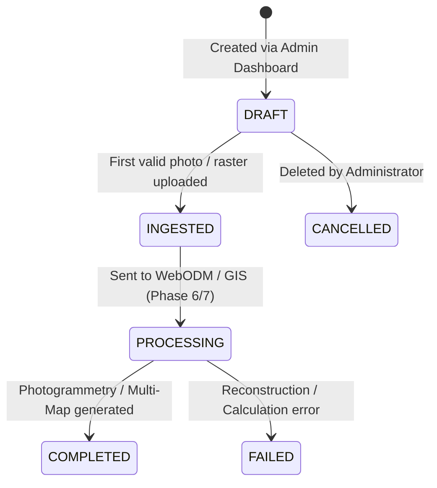

# AgriDrone AutoMap — Survey Flight Management Guide
## Document Reference: `docs/phase-5/survey-management.md`
**Phase**: Phase 5 — Admin Dashboard, Farm/Survey Management & Drone Image Ingestion  
**Status**: APPROVED DESIGN & IMPLEMENTATION  
**Version**: 1.0.0  

---

## 1. Survey Mission Lifecycle & State Machine

A **Survey** represents a single drone flight operation conducted over an agricultural field on a specific date to collect aerial imagery.

### Survey State Machine

- **`DRAFT`**: Initial mission record initialized with flight parameters (altitude, drone model, sensor type). No validated datasets uploaded yet.
- **`INGESTED`**: At least one aerial dataset has been uploaded, validated, and persisted in object storage.
- **`PROCESSING`**: Dispatched to WebODM cluster (Phase 6) or Algorithm Engine (Phase 7).
- **`COMPLETED`**: Final orthomosaic, DSM, and vegetation index layers generated and published.
- **`FAILED`**: Ingestion or processing failure requiring operational review.

---

## 2. Survey Mission Metadata

| Field | Database Type | Description | Validation |
| :--- | :--- | :--- | :--- |
| **`id`** | `UUID` (PK) | Globally unique survey identifier | Auto-generated UUIDv4 |
| **`field_id`** | `UUID` (FK) | Reference to target field parcel | Enforces relational integrity (HTTP 404 if missing) |
| **`survey_code`** | `VARCHAR(50)` | Human-readable identifier (e.g. `SRV-2026-001`) | Unique index; auto-sequenced if omitted |
| **`flight_date`** | `DATE` | Date flight was executed | Required ISO format (`YYYY-MM-DD`) |
| **`drone_model`** | `VARCHAR(100)` | Hardware platform (e.g. DJI Mavic 3 Enterprise) | Max length 100 characters |
| **`sensor_type`** | `VARCHAR(50)` | Sensor class: `RGB` or `MULTISPECTRAL` | Capitalized enum string |
| **`flight_altitude_m`**| `NUMERIC(6, 2)`| Nominal Above Ground Level (AGL) altitude | Valid range: 5.0 m to 500.0 m |
| **`status`** | `VARCHAR(30)` | Current mission state | Indexed; defaults to `DRAFT` |
| **`coverage_geom`** | `GEOMETRY(POLYGON, 4326)` | Flight path or survey perimeter polygon | Optional valid PostGIS polygon |

---

## 3. Automated Code Generation & Uniqueness

If the administrator does not specify a custom survey code during creation, the backend automatically generates a sequential mission code using the formula:
$$\text{Code} = \text{SRV-} + \text{FlightYear} + \text{-} + \text{SequenceNumber (zero-padded to 3 digits)}$$
Examples: `SRV-2026-001`, `SRV-2026-002`.

If a collision occurs due to concurrent requests, the generator advances the sequence until a unique code is reserved.
