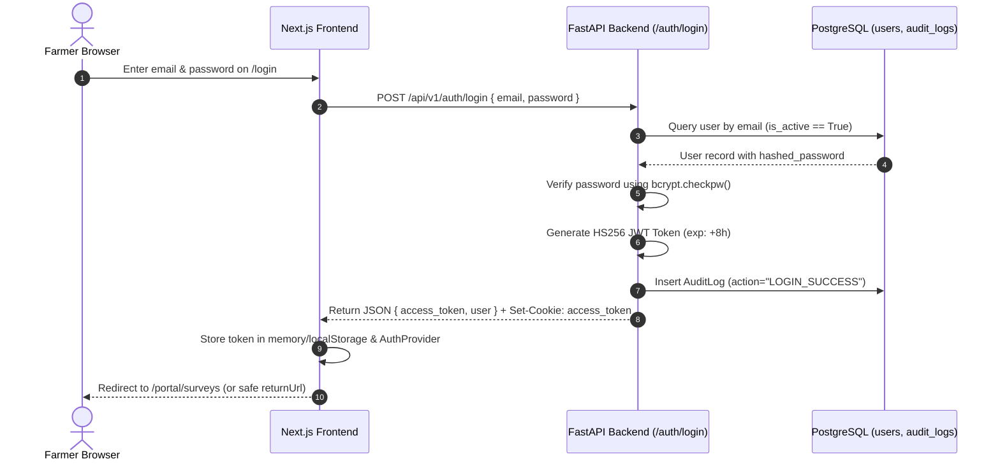

# Authentication & Session Management Design

**Document:** Architecture Specification — Phase 9  
**Status:** Implemented & Verified  
**Date:** October 2026  

---

## 1. Overview

AgriDrone AutoMap implements a dual token-and-cookie session architecture designed specifically for modern Single Page Applications (Next.js App Router) communicating with a high-performance Python FastAPI geospatial backend.

---

## 2. Authentication Flow



---

## 3. JWT Token Specification

Tokens are generated by `backend/app/core/security.py` using `PyJWT`:

### Header
```json
{
  "alg": "HS256",
  "typ": "JWT"
}
```

### Payload Claims
```json
{
  "sub": "b2f69e6b-1934-4b45-8bc6-94301d6706e5",
  "email": "farmer@greenvalley.local",
  "role": "FARMER",
  "exp": 1729000000,
  "iat": 1728971200,
  "iss": "agridrone-automap",
  "aud": "agridrone-automap-client"
}
```

- `sub` *(Subject)*: Unique UUID of the user in `users.id`.
- `email`: Normalized lowercase email address.
- `role`: System authorization role (`ADMIN`, `AGRONOMIST`, or `FARMER`).
- `exp`: Expiration timestamp (POSIX seconds), defaulted to 480 minutes (8 hours).
- `iat`: Issued-at timestamp.
- `iss` & `aud`: Scoped to `agridrone-automap`.

---

## 4. Cookie Management & Security Attributes

Upon successful authentication at `POST /api/v1/auth/login`, the backend issues an HTTP response cookie:

| Attribute | Value | Description |
| :--- | :--- | :--- |
| **Name** | `access_token` | Stores the signed JWT string |
| **HttpOnly** | `True` | Inaccessible to JavaScript `document.cookie` (mitigates XSS) |
| **SameSite** | `Lax` | Protects against Cross-Site Request Forgery (CSRF) while allowing top-level navigation |
| **Secure** | `False` (dev) / `True` (prod) | Enforced via `COOKIE_SECURE` configuration |
| **Path** | `/` | Available across all API and tile server routes |
| **Max-Age** | 28,800 seconds | Matches the 8-hour token lifespan |

### Dual Verification Strategy
- **Header Authentication (`Authorization: Bearer <token>`)**: Standard for all programmatic API requests executed by `frontend/lib/api.ts`.
- **Cookie Authentication (`access_token`)**: Read automatically by the browser when loading map tiles into MapLibre GL raster layers.
- **Query Parameter Fallback (`?token=<token>`)**: Supported specifically on raster tile endpoints (`/maps/tiles/{id}/{z}/{x}/{y}.png`) to accommodate standalone tile fetchers or web workers.

---

## 5. Logout & Session Termination

Logout operates via `POST /api/v1/auth/logout`:
1. **Backend Action:** Clears the `access_token` cookie by setting `max-age=0` and empty value. An `AuditLog` entry is recorded (`LOGOUT`).
2. **Frontend Action:** Clears `localStorage.removeItem('agridrone_token')` and `agridrone_user`, sets React `user` state to `null`, and redirects to `/login`.
3. **Cache Invalidation:** Resets active farm, survey, product, and tile memory to prevent residual data from remaining in browser memory.

---

## 6. Brute Force Protection & Rate Limiting

The `/auth/login` endpoint incorporates an in-memory sliding window rate limiter:
- **Threshold:** 20 login attempts per 60 seconds per IP address.
- **Exceeded Behavior:** Returns `HTTP 429 Too Many Requests` with header `Retry-After: 60`.
- **Security Benefit:** Protects against credential stuffing and brute-force password guessing without requiring external Redis dependencies during local testing.

---

## 7. Open Redirect Vulnerability Mitigation

In `frontend/app/login/page.tsx`, the `returnUrl` query parameter is strictly validated:
```typescript
const getSafeReturnUrl = (rawUrl: string | null, role?: string): string => {
  if (!rawUrl || !rawUrl.startsWith("/") || rawUrl.startsWith("//") || rawUrl.includes("://")) {
    return role === "FARMER" ? "/portal/surveys" : "/admin/dashboard";
  }
  return rawUrl;
};
```
This guarantees that an attacker cannot construct phishing links such as `/login?returnUrl=https://malicious-site.com`.
