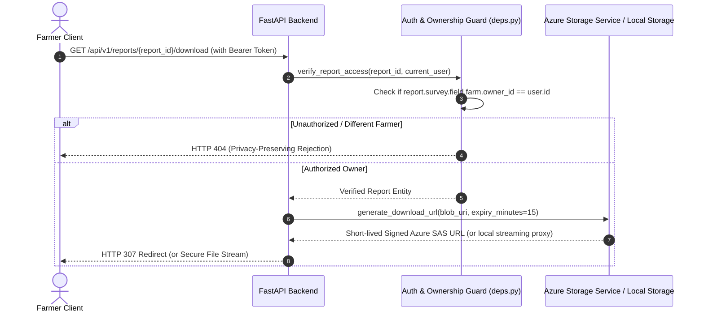

# Private File & Map Access Architecture

**Document:** Storage & GIS Security Specification — Phase 9  
**Status:** Implemented & Verified  
**Date:** October 2026  

---

## 1. Threat Model for Geospatial & Aerial Assets

Agricultural drone mapping generates proprietary binary assets that cannot be secured using simple URL obfuscation:
1. **Raw Drone Imagery:** Unprocessed JPEG/TIFF files with embedded high-precision GPS EXIF tags revealing flight patterns and physical ground assets.
2. **High-Resolution Orthomosaics:** Geospatial Cloud-Optimized GeoTIFFs (COGs) with sub-3cm spatial resolution.
3. **Vegetation Index GeoTIFFs:** Calibrated multispectral index maps representing sensitive yield projections and nutrient deficiencies.
4. **Diagnostic PDF Reports:** Formal agronomic compliance documents containing farm boundaries, acreage, and farm owner identities.

No cloud storage container or local storage folder is ever exposed publicly.

---

## 2. Server-Mediated File Access Workflow

All file requests must pass through the FastAPI application layer for identity validation and relational ownership checks before any data or signed link is returned.



---

## 3. Azure Blob Storage SAS Token Policy

When configured with Microsoft Azure Blob Storage (`AZURE_STORAGE_CONNECTION_STRING`):
- All Azure Blob containers (`raw-surveys`, `orthomosaics`, `vegetation-indices`, `reports`) have Public Access disabled (`Private`).
- The backend uses the official `azure-storage-blob` Python SDK to generate user-specific, short-lived Shared Access Signature (SAS) URLs.
- **SAS Permissions:** Restricted strictly to `BlobSasPermissions(read=True)`.
- **SAS Lifespan:** Maximum 15 minutes (`datetime.now(timezone.utc) + timedelta(minutes=15)`).
- **Narrow Scope:** Scoped to the individual blob path; never at container or account level.

---

## 4. Local Development Storage Security

During local development and automated CI testing (`ALLOW_DEV_LOCAL_STORAGE=true`), files reside on disk in `backend/storage/`:
- Raw files cannot be accessed via static HTTP paths.
- The `GET /api/v1/ingestion/files/{id}/download` endpoint performs ownership traversal (`verify_survey_access`).
- If authorized, the file is streamed via FastAPI `FileResponse` with security headers:
  - `X-Content-Type-Options: nosniff`
  - `Content-Disposition: attachment; filename="..."`
  - `Cache-Control: private, no-transform, max-age=0`

---

## 5. MapLibre GL Tile Authentication

Rendering continuous vegetation index overlays in MapLibre GL JS presents a unique authentication challenge: the browser requests XYZ raster tiles (`/api/v1/maps/tiles/{id}/{z}/{x}/{y}.png`) via internal image loading elements that cannot easily attach custom HTTP headers (`Authorization: Bearer <token>`).

To maintain strict security without degrading map performance or introducing insecure public tile endpoints, AgriDrone AutoMap implements a **Dual Tile Authentication Strategy**:

### Method A: Browser Session Cookie (Primary)
When the user logs in via `/api/v1/auth/login`, the backend issues an `HttpOnly`, `SameSite=Lax` cookie named `access_token`. MapLibre image requests automatically transmit this cookie to the tile server.

### Method B: URL Token Parameter Fallback (Secondary)
For standalone workers or environments where cookie delivery is constrained:
```
GET /api/v1/maps/tiles/{product_id}/{z}/{x}/{y}.png?token=<jwt_access_token>
```
The FastAPI dependency `get_current_user_with_query_fallback` inspects:
1. `Authorization: Bearer ...` header.
2. If absent, reads the `access_token` cookie.
3. If absent, reads the `token` URL query parameter.
4. Once identity is resolved, `verify_map_product_access` confirms that the requesting user owns the underlying survey before rendering the tile.

If the token is missing, expired, or belongs to another farmer, the tile endpoint returns `HTTP 404 Not Found` (privacy-preserving) rather than exposing map tiles.
