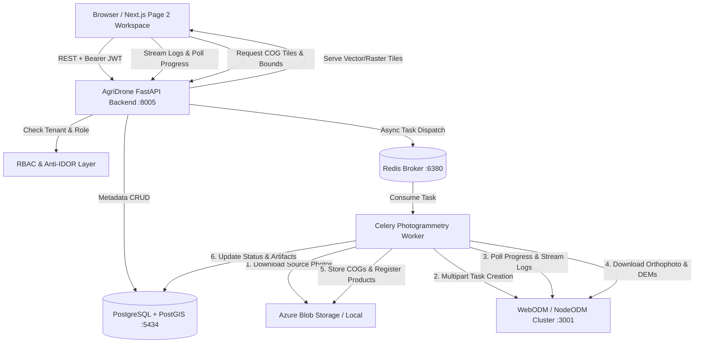

# WebODM Integration Architecture — Page 2: WebODM Photogrammetry Workspace

## 1. Executive Summary & Architectural Overview

Page 2 (**WebODM Photogrammetry Workspace**) provides a unified, production-grade interface for managing photogrammetry projects, ingesting raw drone imagery and Ground Control Points (GCPs), orchestrating OpenDroneMap processing pipelines, monitoring real-time task progress, and viewing high-resolution GIS map outputs.

Rather than copying WebODM's desktop interface or embedding an iframe, AgriDrone AutoMap integrates directly with WebODM/NodeODM via REST APIs and Celery/Redis background orchestration, strictly preserving multi-tenant isolation, Azure Blob Storage persistence, and MapLibre GL JS visualization.

---

## 2. Component Architecture

### 2.1 Next.js App Router Frontend (`frontend/app/admin/photogrammetry/page.tsx`)
- **Visual Design System**: Dark forest-green application shell (`#06140c` / `#0a1f13`), emerald accents (`#059669`, `#10b981`), high contrast typography, accessible forms, and responsive tables.
- **Unified Workspace Tabs**:
  1. **Projects Dashboard**: Searchable, sortable project cards with task counts and status badges.
  2. **Select Images & GCP**: Multi-file drag-and-drop raw photo ingestion + surveyor GCP format parser.
  3. **Processing Tasks**: Real-time lifecycle monitoring, progress percentage, current stage indicators, cancellation/retries, and streaming console terminal drawer.
  4. **Presets & Options**: Agricultural pipeline profiles (Fast 2D, Precision High-Res, Multispectral, Custom GSD).
  5. **View Map & Outputs**: Embedded MapLibre raster inspection with layer switcher and direct GeoTIFF downloads.
  6. **Processing Nodes** *(Admin Only)*: Real-time telemetry, RAM availability, and queue depth for cluster workers.
  7. **Diagnostics** *(Admin Only)*: End-to-end health probe across WebODM, DB, Redis, and storage.
  8. **Administration & Lightning** *(Admin Only)*: Cluster configuration parameters and technical analysis of WebODM Lightning cloud offloading.

### 2.2 FastAPI Backend (`backend/app/api/v1/endpoints/photogrammetry.py`)
- Provides RESTful contracts for projects, task lifecycle, GCP parsing, cluster nodes, and diagnostics.
- Never exposes upstream WebODM credentials or NodeODM ports to the browser.
- Enforces strict role-based access control (`get_current_user` for farmers; `get_current_active_admin` for diagnostic/node controls).
- Enforces multi-tenant ownership guards (`verify_photogrammetry_project_access`, `verify_survey_access`).

### 2.3 WebODM Client Service (`backend/app/services/webodm.py`)
- Communicates with upstream WebODM API (`http://localhost:3001` or configured cluster).
- Features resilient timeout handling, JWT/token authentication, retry policies, and offline fallbacks.
- Includes static `validate_gcp_format()` for validating surveyor GCP coordinate files before dispatch.

### 2.4 Celery Photogrammetry Worker (`backend/app/tasks/photogrammetry.py`)
- Asynchronous orchestration engine decoupling long-running photogrammetry from HTTP request lifecycles.
- Automatically retrieves raw imagery and GCP files from Azure Blob Storage.
- Submits multipart tasks to WebODM, periodically polls progress (0%–100%), persists real-time logs in `task_logs` table, downloads orthophotos and DSMs, converts them to Cloud-Optimized GeoTIFFs (COGs), and registers them in `map_products`.
