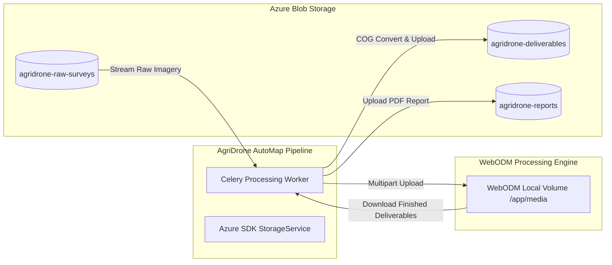

# Azure Blob Storage Integration — Photogrammetry Assets

This document details the file storage architecture, container organization, synchronization mechanisms, and Shared Access Signature (SAS) security policies between AgriDrone AutoMap and Microsoft Azure Blob Storage.

---

## 1. Storage Role Separation

Microsoft Azure Blob Storage is the **official, sovereign cloud storage repository** for all AgriDrone AutoMap assets.

- **WebODM Local Storage**: WebODM stores intermediate Structure-from-Motion files and working assets locally inside its container volume (`/webodm/app/media/project/{p}/task/{t}/`). WebODM has **no native Azure Blob Storage connector**.
- **Synchronization Bridge**: AgriDrone AutoMap's Celery workers serve as the authenticated transfer bridge between Azure Blob Storage and WebODM.

---

## 2. Container Hierarchy & Asset Partitioning

| Container Name | Asset Type | Format | Access Policy | Retention Policy |
|:---|:---|:---|:---|:---|
| `agridrone-raw-surveys` | Original Drone Imagery & GCPs | JPEG, DNG, ZIP, TXT | **Private** | Permanent archive (source of truth) |
| `agridrone-deliverables` | Orthophotos, DSM, DTM, 3D Models | COG GeoTIFF, GLB, LAZ | **Private** | Permanent deliverable storage |
| `agridrone-reports` | Quality & Diagnostic Reports | PDF | **Private** | Permanent report archive |
| `agridrone-temp-cache` | Interim ZIP archives during download | ZIP | **Private** | 24-hour automatic eviction |

---

## 3. Data Flow & Synchronization Lifecycle

### 3.1 Raw Imagery Dispatch to WebODM
1. When a task is dispatched, the Celery worker queries `survey_files` for the survey.
2. The worker streams the raw photographs and the optional `gcp_list.txt` from Azure Blob Storage into memory buffers or a secure temporary directory (`/tmp/agridrone_task_{task_id}/`).
3. The files are streamed via HTTP multipart POST to WebODM (`/api/projects/{p}/tasks/`).
4. Intermediate temporary files on the worker are scrubbed immediately. Original raw imagery in Azure Blob Storage is **never deleted**.

### 3.2 Output Deliverables Ingestion to Azure
1. When WebODM reports status `40` (`COMPLETED`), the Celery worker retrieves:
   - `orthophoto.tif` (2D mosaic)
   - `dsm.tif` (Digital Surface Model)
   - `dtm.tif` (Digital Terrain Model, if enabled)
   - `textured_model.glb` (3D web model, if generated)
   - `report.pdf` (Quality summary report)
2. **Cloud-Optimized GeoTIFF Conversion**:
   - The worker runs GDAL `gdal_translate -co TILED=YES -co COMPRESS=DEFLATE -co COPY_SRC_OVERVIEWS=YES` to produce an indexed COG.
3. **Upload to Azure**:
   - The COG is uploaded to `agridrone-deliverables/{survey_id}/{task_id}/orthophoto_cog.tif`.
   - The blob URI is stored in the PostgreSQL `map_products` table.
4. **WebODM Cleanup Policy**:
   - Completed tasks in WebODM are retained for a configurable cache window (`WEBODM_TASK_RETENTION_DAYS=7`) to allow live TMS tile proxying before local volume reclamation.

---

## 4. Security & Short-Lived SAS URLs

To maintain strict data isolation and zero public exposure:
1. **Private by Default**: All Azure Blob containers have public access disabled (`PublicAccessType.None`).
2. **Authorized SAS Token Generation**:
   - When an authenticated user requests an asset download, the FastAPI backend checks tenant ownership.
   - If authorized, the backend generates a **Shared Access Signature (SAS) URL** with:
     - Read-only permission (`BlobSasPermissions(read=True)`).
     - Narrow validity window (default: 15 minutes).
     - Bound to the specific blob path.
3. **Tile Proxy Streaming**:
   - For web map rendering, tiles are streamed directly through the authenticated FastAPI proxy, ensuring no raw Azure container credentials or SAS URLs are leaked in frontend network logs.
