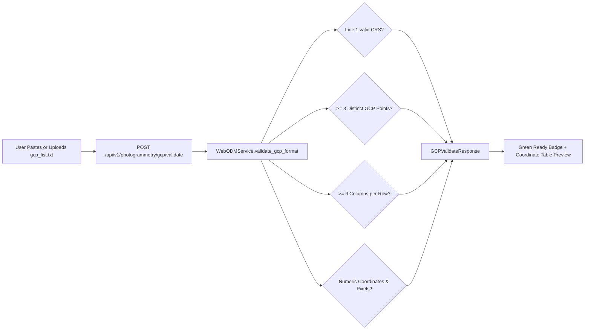

# Ground Control Point (GCP) Workflow & OpenDroneMap Format

## 1. Purpose of Ground Control Points (GCPs)

While modern agricultural survey drones (e.g., DJI Mavic 3 Enterprise, Phantom 4 RTK) record onboard GNSS coordinates, consumer GPS can drift by 1–5 meters. For high-precision agricultural operations—such as sub-inch auto-steer tractor planting, drainage tile installation, and multi-temporal canopy growth comparisons—**Ground Control Points (GCPs)** tie the photogrammetric bundle adjustment to surveyed ground markers with millimeter accuracy.

---

## 2. OpenDroneMap GCP Specification

AgriDrone AutoMap supports the standard OpenDroneMap GCP specification (`gcp_list.txt`).

### File Structure
- **Line 1 (Header)**: The Coordinate Reference System (CRS) as an EPSG code or PROJ4 string.
- **Lines 2+ (Data Rows)**: 6 or 7 whitespace-delimited columns:
  ```
  <easting_x> <northing_y> <elevation_z> <pixel_x> <pixel_y> <image_name> [gcp_name]
  ```

### Example Valid `gcp_list.txt`
```text
+proj=utm +zone=43 +datum=WGS84 +units=m +no_defs
385200.12 2011400.45 540.23 1250 820 DJI_0001.JPG GCP_1
385200.12 2011400.45 540.23 1400 950 DJI_0002.JPG GCP_1
385220.89 2011410.60 541.02 1650 1100 DJI_0002.JPG GCP_2
385220.89 2011410.60 541.02 1200 800 DJI_0003.JPG GCP_2
385240.34 2011430.12 540.88 1800 1350 DJI_0004.JPG GCP_3
```

---

## 3. Real-Time Validation Pipeline

Before dispatching a photogrammetry task to WebODM, the user can validate their GCP file using the integrated GCP interface in Page 2.



### Validation Rules Enforced
1. **CRS Integrity**: Header must start with `+proj=`, `EPSG:`, or be a recognized projection system.
2. **Minimum Triangulation Requirements**: OpenDroneMap requires at least **3 distinct non-collinear GCP markers** to solve 3D exterior orientation parameters.
3. **Column Structure**: Each data row must have at least 6 tokens (`X Y Z px py img`).
4. **Coordinate Ranges**: Easting, northing, elevation, and pixel values must parse to valid floating-point numbers without `NaN` or `Inf`.
5. **Image Association**: Image filenames must match raw photos staged in the survey.

---

## 4. Integration with Task Creation & Worker

When a task is launched with an attached GCP file:
1. The validated GCP text is stored in `survey_files` as a `GCP` asset.
2. `PhotogrammetryTask.gcp_file_id` and `gcp_applied` are populated in PostgreSQL.
3. The Celery worker downloads the `gcp_list.txt` file and includes it in the multipart POST request sent to WebODM (`/task/new` with `gcp` file part).
4. WebODM runs the GCP bundle adjustment during Structure from Motion (SfM) matching.
