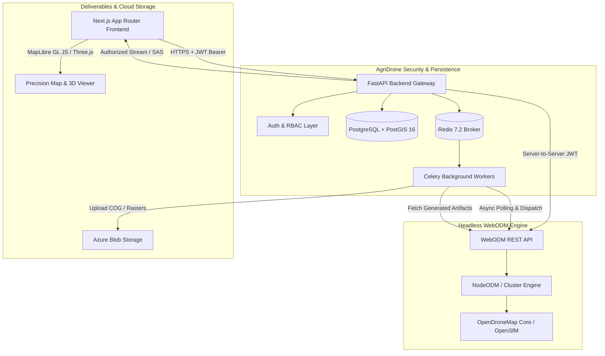

# AgriDrone AutoMap & WebODM Integration Architecture

## 1. Architectural Philosophy & Guiding Principles

AgriDrone AutoMap integrates **WebODM 3.3.1** as a headless photogrammetry processing service. The core architectural mandate is:
- **AgriDrone AutoMap is the sovereign application**: Farmers, farms, fields, surveys, agricultural analytics, and crop health indices are strictly owned by AgriDrone AutoMap.
- **WebODM is an independent photogrammetry engine**: Processing node clusters, Structure-from-Motion (SfM) pipelines, and point cloud densification are executed within the WebODM container ecosystem.
- **Strict Boundary Separation**:
  - No direct SQL access to WebODM's internal PostgreSQL database.
  - No importing of WebODM internal Django models into FastAPI.
  - No exposure of WebODM administrative credentials or private service endpoints to the browser.
  - All communication occurs via authenticated, validated, and logged REST API contracts.

---

## 2. Component Roles & Communication Pathways

### 2.1 Next.js 14 Frontend (App Router, TypeScript, Tailwind CSS)
- **Role**: Presentation and user interaction layer. Provides the unified 5-page interface:
  1. Admin Dashboard & Drone Image Ingestion
  2. WebODM Photogrammetry Workspace
  3. Algorithm & Multi-Map Generation
  4. Secure Farmer Portal
  5. Diagnostics & Actionable Insights
- **Security Boundary**: Contains zero WebODM tokens or direct WebODM endpoints. All requests target `/api/v1/...` on the AgriDrone FastAPI backend.

### 2.2 FastAPI Backend (Python 3.12, SQLAlchemy, Pydantic)
- **Role**: Sovereign API gateway, orchestrator, and security enforcement authority.
- **Responsibilities**:
  1. Authenticates users and validates tenant ownership (`verify_farm_access`, `verify_task_access`).
  2. Validates incoming datasets (rejecting non-aerial or pre-stitched GeoTIFFs from SfM workflows).
  3. Translates agricultural presets into WebODM parameter lists.
  4. Manages server-to-server JWT authentication with WebODM (`/api/token-auth/`).
  5. Proxies raster tiles, metadata, logs, and downloads securely with rate limiting and logging.

### 2.3 Celery & Redis Worker Cluster
- **Role**: Asynchronous execution of long-running operations.
- **Responsibilities**:
  1. Pulls raw drone images from Azure Blob Storage or local staging.
  2. Assembles multipart payloads and submits tasks to WebODM.
  3. Monitors WebODM task progress sequentially, storing console logs in PostgreSQL.
  4. Upon task completion, downloads `orthophoto.tif`, `dsm.tif`, and `dtm.tif`.
  5. Converts standard GeoTIFFs into Cloud-Optimized GeoTIFFs (COGs) using GDAL/Rasterio and uploads them to Azure Blob Storage.
  6. Registers new `MapProduct` records in PostgreSQL, automatically linking them to the survey and field.

### 2.4 WebODM & NodeODM Cluster
- **Role**: Photogrammetry execution engine.
- **Responsibilities**:
  1. Image feature extraction (SIFT/AKAZE).
  2. Match points and bundle adjustment via OpenSfM.
  3. Dense point cloud generation via OpenMVS.
  4. 2D orthomosaic generation via GDAL.
  5. Digital Surface Model (DSM) and Digital Terrain Model (DTM) extraction.
  6. Dynamic raster TMS tile rendering on-demand.

---

## 3. Data Synchronization & Source of Truth

To prevent dual-master conflicts and data corruption, ownership is cleanly partitioned:

| Data Entity | Authoritative Master | Secondary Mirror / Synchronized Attribute | Reconciliation Policy |
|:---|:---|:---|:---|
| **Farmer, Farm, Field** | AgriDrone AutoMap (PostgreSQL) | None (WebODM is completely unaware of farms) | N/A |
| **Survey Metadata** | AgriDrone AutoMap (PostgreSQL) | WebODM Project Name (e.g. `AgriDrone - Survey #XYZ`) | One-way push from AgriDrone to WebODM |
| **Photogrammetry Task State** | WebODM Engine | `PhotogrammetryTask.status` in PostgreSQL | WebODM is ground truth. Poller syncs integer status codes (10–50) |
| **Execution Logs** | WebODM Engine Console | `TaskLog` in PostgreSQL | Appended during poller execution; immutable audit record |
| **GeoTIFF / COG Deliverables** | Azure Blob Storage | Local WebODM cache (`/app/media/...`) | WebODM outputs are ingested to Azure; Azure is long-term master |
| **Processing Nodes** | NodeODM Cluster | Dynamic query via `/api/v1/photogrammetry/nodes` | Live query; never persisted in database |

---

## 4. Failure Modes & Graceful Degradation

1. **WebODM Offline / Container Restart**:
   - The diagnostics engine detects `OFFLINE` status via `/api/v1/photogrammetry/cluster-status`.
   - The frontend displays an alert banner explaining that the photogrammetry engine is offline.
   - Pre-existing map products, surveys, farmer records, and GIS algorithm pages remain 100% operational because deliverables are served from Azure Blob Storage or cached COGs.
2. **Network Timeout during Multipart Upload**:
   - FastAPI client uses configurable timeout (`WEBODM_TIMEOUT_SECONDS=120`).
   - If timeout occurs, the task record is marked as `FAILED` with explicit error message, and user can trigger `/tasks/{task_id}/retry` when cluster recovers.
3. **Task Failure on NodeODM (e.g. Insufficient Overlap)**:
   - WebODM returns status `30` (`FAILED`) with `last_error`.
   - AgriDrone poller records the error trace, updates `task.error_message`, and logs recommendations (e.g. "Increase flight overlap to 75% or upload more images").
