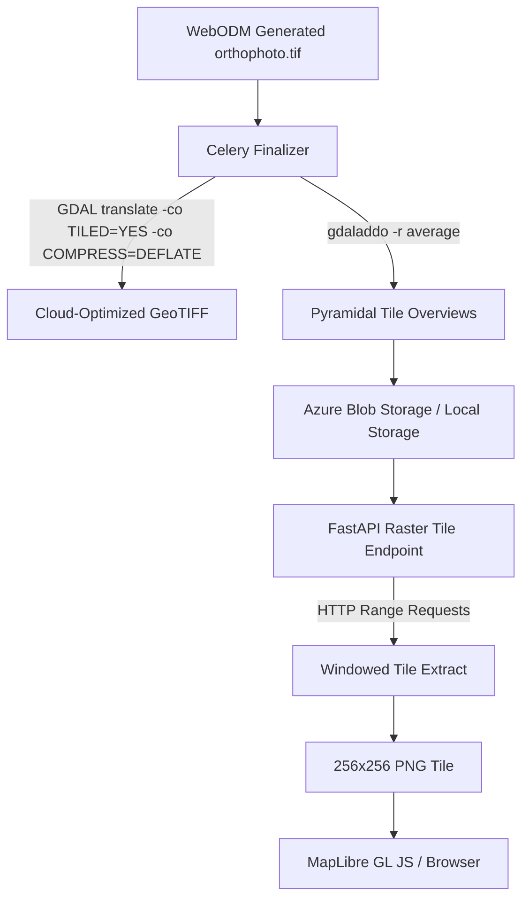

# Map & Output Delivery Architecture

## 1. Cloud-Optimized GeoTIFF (COG) Delivery Pipeline

When WebODM completes orthorectification and elevation generation, raw GeoTIFF files can range from 500 MB to 10+ GB. Downloading multi-gigabyte rasters directly into client browsers causes severe browser crashes and memory exhaustion.

AgriDrone AutoMap solves this using Cloud-Optimized GeoTIFFs (COGs) and dynamic tile serving:

---

## 2. Supported Output Deliverables

| Deliverable Type | Product Code | Typical Bands | CRS Projection | Description |
| :--- | :--- | :--- | :--- | :--- |
| **Orthophoto (RGB)** | `ORTHOPHOTO` | 3 (Red, Green, Blue) | Universal Transverse Mercator (UTM) | Geometrically corrected, seamless aerial mosaic of the entire field. |
| **Digital Surface Model** | `DSM` | 1 (Elevation in Meters) | UTM | Topographic surface including crop canopy height, trees, and buildings. |
| **Digital Terrain Model** | `DTM` | 1 (Ground Elevation) | UTM | Bare-earth elevation model filtered for slope, drainage, and irrigation planning. |
| **Multispectral Reflectance** | `MULTISPECTRAL` | 4–5 (Blue, Green, Red, RedEdge, NIR) | UTM | Calibrated reflectance used directly by Phase 7 algorithms to compute NDVI, NDRE, and SAVI. |

---

## 3. MapLibre GL JS Integration

Page 2 embeds MapLibre GL JS to provide:
1. **Interactive Layer Toggles**: Switch between Orthophoto RGB, DSM Elevation, and DTM.
2. **Dynamic Opacity Slider**: Blend drone orthophoto over OpenStreetMap base tiles to verify field boundaries.
3. **Continuous Zoom & Pan**: Sub-inch inspection without raster pixelation via pyramidal overviews.
4. **Direct GeoTIFF Download**: Authenticated endpoint `/api/v1/maps/products/{id}/download` for QGIS/ArcGIS desktop export.
