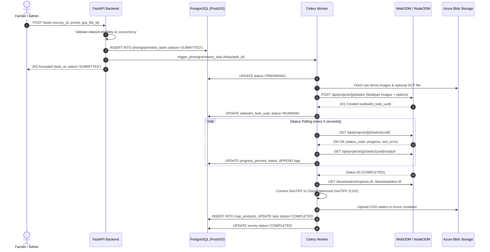

# Project and Task Workflows — WebODM Photogrammetry

This document outlines the end-to-end lifecycle, state transitions, concurrency controls, and failure recovery mechanisms for photogrammetry projects and tasks in AgriDrone AutoMap.

---

## 1. Project Management Lifecycle

### 1.1 Project Creation & Upstream Association
1. User submits project details (`name`, `description`, `farm_id`, `field_id`, `survey_id`) via `POST /api/v1/photogrammetry/projects`.
2. Backend verifies tenant ownership of the referenced `farm_id` and `survey_id`.
3. An active `PhotogrammetryProject` record is persisted in PostgreSQL.
4. If WebODM is online, the backend invokes `POST /api/projects/` on WebODM to provision an upstream container. The assigned integer ID is saved in `project.webodm_project_id`. If WebODM is offline, local project creation still succeeds gracefully (decoupled operation).

### 1.2 Project Updates & Renaming
- Renaming a project updates `photogrammetry_projects.name` locally and dispatches a `PATCH /api/projects/{webodm_project_id}/` request upstream.
- Audit logs record all modifications with the executing user's UUID.

### 1.3 Project Deletion
- Deleting a project checks whether any tasks are currently in `RUNNING` or `UPLOADING` state. If active tasks exist, deletion is rejected with HTTP `409 Conflict`.
- Upon confirmation, upstream containers on WebODM are deleted via `DELETE /api/projects/{webodm_project_id}/`, local tasks and associations are removed, and an audit entry is generated.

---

## 2. Photogrammetry Task Lifecycle

---

## 3. Concurrency & Idempotency Controls

1. **One Active Task Per Survey**:
   - AgriDrone AutoMap prevents concurrent task dispatches for the same survey. If a task is already in `SUBMITTED`, `QUEUED`, `PREPARING`, `UPLOADING`, `RUNNING`, or `FINALIZING` state, new submissions are rejected with `HTTP 409 Conflict`.
2. **Duplicate Submission Protection**:
   - Frontend disables submit buttons upon click and renders a loading spinner.
   - Idempotency checks in FastAPI verify dataset hash and survey state before creating database records.

---

## 4. Failure Recovery & Cancellation Workflows

### 4.1 Cancellation (`POST /tasks/{task_id}/cancel`)
- If the task is running upstream, `POST /api/projects/{p}/tasks/{uuid}/cancel/` is dispatched to WebODM.
- Local task state transitions immediately to `CANCELLED`, `completed_at` is stamped, and a warning log is recorded.
- The parent survey is reverted to `DRAFT` so the user can re-configure or re-upload imagery.

### 4.2 Retry (`POST /tasks/{task_id}/retry`)
- Only tasks in `FAILED` or `CANCELLED` state can be retried.
- Retrying increments `task.retry_count`. If `retry_count >= WEBODM_MAX_RETRIES` (default: 3), the request is rejected with `HTTP 400 Bad Request`.
- The task state is reset to `SUBMITTED`, errors are cleared, progress is reset to 0%, and Celery is re-triggered.
