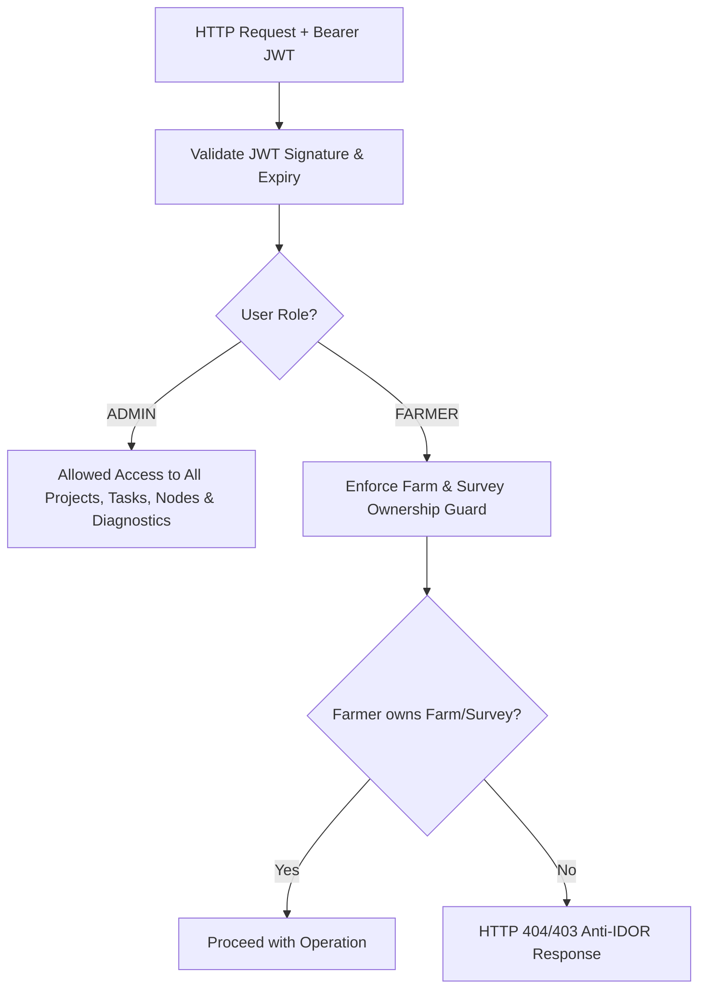

# Security & Role-Based Permissions (RBAC) Specification

## 1. Authentication & Tenant Authorization Principles

AgriDrone AutoMap enforces strict multi-tenant isolation and role-based access control (RBAC) across all WebODM integration endpoints.

---

## 2. Endpoint Permission Matrix

| Endpoint | Method | Required Role | Tenant Isolation Scope |
| :--- | :--- | :--- | :--- |
| `/photogrammetry/projects` | `GET` | `FARMER` or `ADMIN` | Filtered by `owner_id == user.id` for Farmers. |
| `/photogrammetry/projects` | `POST` | `FARMER` or `ADMIN` | Verifies `farm_id` belongs to caller before linking. |
| `/photogrammetry/projects/{id}` | `GET` | `FARMER` or `ADMIN` | Strictly blocked if owned by another farmer. |
| `/photogrammetry/projects/{id}` | `PATCH` | `FARMER` or `ADMIN` | Modifiable only by project owner or administrator. |
| `/photogrammetry/projects/{id}` | `DELETE`| `FARMER` or `ADMIN` | Deletable only by project owner or administrator. |
| `/photogrammetry/gcp/validate` | `POST` | `FARMER` or `ADMIN` | Format validation open to authenticated callers. |
| `/photogrammetry/tasks` | `POST` | `FARMER` or `ADMIN` | Farmer must own survey linked to the task. |
| `/photogrammetry/tasks/{id}` | `GET` | `FARMER` or `ADMIN` | Farmer must own survey associated with task. |
| `/photogrammetry/tasks/{id}/cancel`| `POST` | `FARMER` or `ADMIN` | Farmer must own survey associated with task. |
| `/photogrammetry/tasks/{id}/retry` | `POST` | `FARMER` or `ADMIN` | Farmer must own survey associated with task. |
| `/photogrammetry/nodes` | `GET` | **`ADMIN` ONLY** | **Blocked (`403 Forbidden`) for farmers.** |
| `/photogrammetry/diagnostics` | `GET` | **`ADMIN` ONLY** | **Blocked (`403 Forbidden`) for farmers.** |
| `/photogrammetry/admin/config` | `GET` | **`ADMIN` ONLY** | **Blocked (`403 Forbidden`) for farmers.** |

---

## 3. Anti-IDOR (Insecure Direct Object Reference) Protection

1. **Existence Obfuscation**: When Farmer A requests a project or survey belonging to Farmer B, the system returns `HTTP 404 Not Found` rather than leaking whether the resource exists.
2. **Backend Enforcement**: Frontend UI tabs for Nodes, Diagnostics, and Admin are not merely hidden in the interface; the backend FastAPI router rejects unauthorized requests with `HTTP 403 Forbidden`.
3. **Audit Logging**: Destructive operations (`DELETE_PHOTOGRAMMETRY_PROJECT`, `CANCEL_TASK`) record user ID, IP address, and timestamp in the `audit_logs` table.
