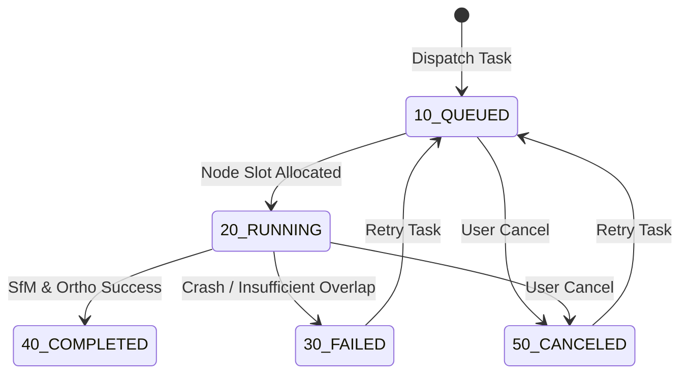

# WebODM Source Code Audit & Technical Analysis

**Target Source**: `WebODM-master.zip` (Extracted at `WebODM-master/WebODM-master`)  
**Identified Upstream Version**: **WebODM 3.3.1** (Release Tag: `v3.3.1`)  
**Primary Authors & Copyright**: Piero Toffanin / UAV4GEO  
**License**: **GNU Affero General Public License v3.0 (AGPL-3.0)**  
**Integration Target**: AgriDrone AutoMap (Unified Agricultural Drone Mapping Platform)

---

## 1. Executive Summary

A comprehensive architectural and security audit of the upstream WebODM 3.3.1 source code was conducted to determine its internal mechanics, API boundaries, task lifecycles, and compatibility with the existing AgriDrone AutoMap platform. 

WebODM is architected as an orchestration and photogrammetry visualization platform comprising:
1. **Django 4.x Web Application**: Providing REST APIs, user authentication, asset storage, and tiler services.
2. **Celery & Redis Worker Cluster**: Managing asynchronous task polling, NodeODM dispatching, zip extraction, and background asset generation.
3. **NodeODM / ClusterODM Processing Engine**: Standalone processing microservices wrapping OpenDroneMap (ODM) and OpenSfM engines.
4. **Angular Frontend Client**: WebODM's built-in web dashboard (which AgriDrone AutoMap integrates via API, preserving AgriDrone's Next.js 14 App Router).

AgriDrone AutoMap does **not** import WebODM internal Django models or couple directly to WebODM's PostgreSQL database. Instead, AgriDrone AutoMap acts as the sovereign agricultural platform, consuming WebODM via authenticated server-to-server REST interfaces (`/api/token-auth/`, `/api/projects/`, `/api/tasks/`, `/api/processingnodes/`, and the tile proxy).

---

## 2. Directory Structure & Key Subsystems

```
WebODM-master/
├── app/
│   ├── api/                  # Django REST Framework endpoints & viewsets
│   │   ├── urls.py           # Core routing table (Projects, Tasks, Tiler, Overlays)
│   │   ├── projects.py       # Project listing, creation, permission checks
│   │   ├── tasks.py          # Task creation, options parser, multipart upload, restart
│   │   ├── tiler.py          # Dynamic raster XYZ/TMS tile server, hillshade & colormaps
│   │   ├── processingnodes.py# NodeODM telemetry, worker queue inspection
│   │   ├── presets.py        # Pipeline presets (fast-orthophoto, high-res, dsm)
│   │   └── media.py          # Task media, panoramas, and thumbnail generation
│   ├── models/               # Relational data layer
│   │   ├── project.py        # Project ownership & permissions
│   │   ├── task.py           # Task status codes (10, 20, 30, 40, 50), assets, options
│   │   ├── processingnode.py # Cluster node endpoints, token, capacity
│   │   └── preset.py         # Stored parameter presets
│   ├── classes/
│   │   ├── gcp.py            # Ground Control Point parser, CRS detection & validation
│   │   ├── options.py        # NodeODM options schema builder & validation
│   │   └── tiler.py          # GDAL/Rasterio TMS tile rendering engine
│   └── templates/            # WebODM internal Django templates & 3D viewers (Potree, Cesium)
├── worker/                   # Celery asynchronous task worker
│   ├── tasks.py              # Background polling of NodeODM tasks & asset downloading
│   └── docker-entrypoint.sh  # Worker bootstrapping
└── plugins/                  # Modular plugin subsystem (Lightning, CloudODM, etc.)
```

---

## 3. Subsystem Deep-Dive

### 3.1 Task Lifecycle & Status Codes
WebODM uses explicit integer status codes stored in `Task.status` (`app/models/task.py`):

| Code | WebODM Constant | Meaning | AgriDrone AutoMap Mapping |
|:---:|:---|:---|:---|
| **10** | `QUEUED` | Task is queued awaiting processing node slot | `QUEUED` |
| **20** | `RUNNING` | SfM / orthophoto pipeline is active on NodeODM | `RUNNING` |
| **30** | `FAILED` | Process failed; error trace captured in `last_error` | `FAILED` |
| **40** | `COMPLETED` | Artifacts generated, extracted, and ready for serving | `COMPLETED` |
| **50** | `CANCELED` | Task was stopped by user or administrator | `CANCELLED` |

**State Transitions**:


### 3.2 File Upload & Ingestion Mechanism
WebODM 3.3.1 supports two distinct upload flows:
1. **Atomic Multipart Upload**:
   - `POST /api/projects/{project_id}/tasks/`
   - Form fields: `name`, `options` (JSON string), `images` (multiple file binaries), `gcp` (optional `.txt` file).
   - *Best for smaller datasets (< 100 images) or pre-batched server dispatch.*
2. **Chunked Partial Upload**:
   - Step 1: `POST /api/projects/{p}/tasks/` with `partial=True`.
   - Step 2: Sequential `POST /api/projects/{p}/tasks/{t}/upload/` with image chunks.
   - Step 3: `POST /api/projects/{p}/tasks/{t}/commit/` to trigger worker processing.

### 3.3 Ground Control Points (GCP) Specification
Audited in `app/classes/gcp.py`:
- Format: OpenDroneMap standard tab/space-delimited `.txt` file.
- Header (Line 1): Coordinate Reference System (CRS). Supports Proj4 strings (e.g. `+proj=utm +zone=43 +datum=WGS84 +units=m +no_defs`) or EPSG codes (e.g. `EPSG:32643`, `WGS84 UTM zone 43N`).
- Body Lines: `X Y Z pixel_x pixel_y image_name [gcp_id]`
- Validation Rule: Minimum 3 non-collinear Ground Control Points are strictly required for 3D Helmert/affine georeferencing.

### 3.4 Dynamic Tile Serving & Raster Metadata
Audited in `app/api/tiler.py`:
- **Tilejson**: `GET /api/projects/{p}/tasks/{t}/{tile_type}/tiles.json`
- **TMS/XYZ Tiles**: `GET /api/projects/{p}/tasks/{t}/{tile_type}/tiles/{z}/{x}/{y}.png`
  - Supported `tile_type` values: `orthophoto`, `dsm`, `dtm`.
  - Query parameters:
    - `colormap`: Viridis, Plasma, Inferno, Magma, Terrain, Rainbow, Greys.
    - `hillshade`: `1` (computes live shaded relief on elevation rasters).
    - `min` / `max`: Elevation dynamic range clamping in meters.
- **Bounds**: `GET /api/projects/{p}/tasks/{t}/{tile_type}/bounds/` returns `[minX, minY, maxX, maxY]` in EPSG:4326.
- **Metadata**: Returns raster dimensions, resolution (GSD), band count, NoData values, and color channel histograms.

### 3.5 3D Model, Point Cloud & Gaussian Splatting
Audited in `app/api/urls.py` & `app/templates/app/3d/`:
- **Point Clouds**: WebODM outputs `georeferenced_model.laz` and builds Potree point cloud Octrees.
- **Textured Meshes**: Outputs `textured_model.glb` (glTF binary) and `textured_model.obj`.
- **Gaussian Splatting**: Added in WebODM 3.x under `/api/projects/{p}/tasks/{t}/splats/`, rendering real-time 3D Gaussian Splats via WebGL.
- **Downloads**: `GET /api/projects/{p}/tasks/{t}/download/{asset_name}` allows direct binary retrieval of:
  - `all.zip` (full archive)
  - `orthophoto.tif` (GeoTIFF)
  - `dsm.tif` (Digital Surface Model GeoTIFF)
  - `dtm.tif` (Digital Terrain Model GeoTIFF)
  - `report.pdf` (Quality summary report)
  - `textured_model.glb` (3D web mesh)

### 3.6 Processing Nodes Telemetry
Audited in `app/api/processingnodes.py`:
- Endpoint: `GET /api/processingnodes/`
- Properties reported: `id`, `name`, `hostname`, `port`, `online` (boolean), `queue_count`, `available_memory` (bytes), `version`.
- Dynamic Schema: `GET /api/processingnodes/{id}/options/` returns the complete list of NodeODM CLI flags, their types, defaults, and descriptions.

---

## 4. Architectural Compatibility Findings

1. **FastAPI vs. Django Compatibility**:
   - WebODM uses Django REST Framework with Token/JWT authentication.
   - AgriDrone AutoMap's FastAPI backend acts as an authenticated API gateway. WebODM credentials never touch the browser.
2. **Azure Blob Storage vs. Local File System**:
   - WebODM stores task outputs in `/webodm/app/media/project/{p}/task/{t}/`.
   - AgriDrone AutoMap ingests raw survey files from Azure Blob Storage, provides them to WebODM, and upon task completion, copies validated deliverables (`orthophoto.tif`, `dsm.tif`, `dtm.tif`) into Azure Blob Storage with Cloud-Optimized GeoTIFF (COG) indexing.
3. **Multi-Tenancy & Data Isolation**:
   - WebODM has project-level permissions but lacks AgriDrone's granular Farmer-Farm-Field-Survey hierarchical access controls.
   - AgriDrone AutoMap enforces tenant isolation at the FastAPI dependency layer (`verify_task_access`, `verify_farm_access`).
