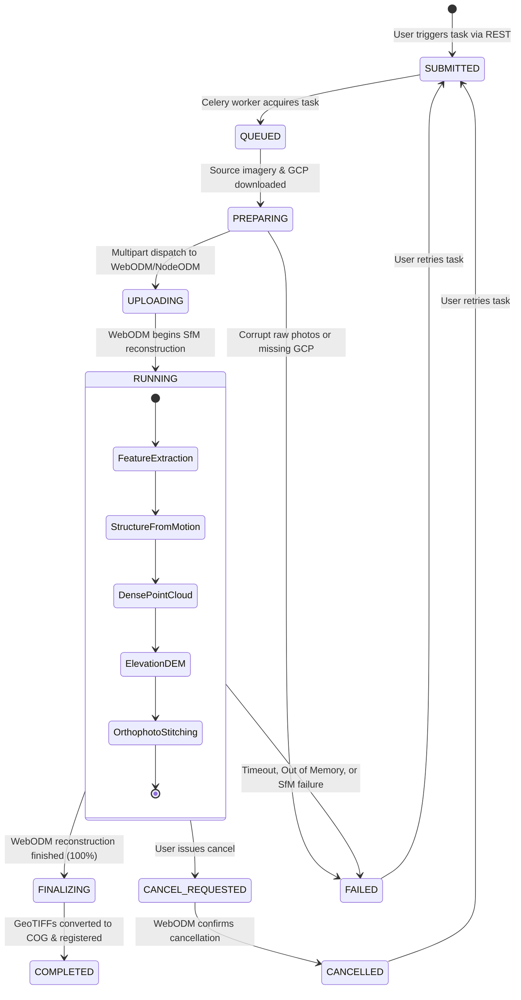

# WebODM Task Lifecycle & State Transitions

## 1. Overview

AgriDrone AutoMap orchestrates OpenDroneMap tasks through an asynchronous Celery background worker, tracking progress from raw photograph ingestion to Cloud-Optimized GeoTIFF registration.

---

## 2. State Mapping Table

| Application State | WebODM Engine State | Progress % | Description |
| :--- | :--- | :--- | :--- |
| **`SUBMITTED`** | N/A (Internal) | 0% | Task record registered in PostgreSQL database; Celery message published to Redis. |
| **`QUEUED`** | `QUEUED` / `0` | 2% | Worker picked up task and checked cluster node availability. |
| **`PREPARING`** | N/A (Internal) | 5% | Raw photographs and GCP coordinate files downloaded from Azure Blob Storage to worker scratch directory. |
| **`UPLOADING`** | N/A (Internal) | 10% | Multipart payload stream sent to WebODM `/task/new` endpoint. |
| **`RUNNING`** | `RUNNING` / `20` | 15% – 90% | WebODM is executing feature extraction, SfM matching, dense point cloud generation, and orthophoto stitching. Real-time stage and progress are updated. |
| **`FINALIZING`**| `COMPLETED` / `40`| 95% | Reconstruction completed on node; worker is downloading `orthophoto.tif` and `dsm.tif`, generating GDAL overviews, and uploading to storage. |
| **`COMPLETED`** | `COMPLETED` / `40`| 100% | Cloud-Optimized GeoTIFFs (COGs) registered in `map_products` and ready for MapLibre visualization. |
| **`FAILED`** | `FAILED` / `30` | Previous | Execution halted. Error trace written to `task_logs` table. User can inspect console and retry. |
| **`CANCELLED`**| `CANCELED` / `50`| Previous | Task aborted per user request. WebODM worker process terminated. |

---

## 3. Concurrency & Idempotency Controls

1. **One Active Task Per Survey Guard**:
   - `POST /api/v1/photogrammetry/tasks` queries PostgreSQL for tasks with status in `["SUBMITTED", "QUEUED", "PREPARING", "UPLOADING", "RUNNING", "FINALIZING"]`.
   - Returns `HTTP 409 Conflict` if an active job already exists, preventing duplicate submissions and GPU thrashing.
2. **Terminal State Guards**:
   - Only tasks in `FAILED` or `CANCELLED` states can be retried.
   - Retrying increments `retry_count` and preserves the original options payload.
3. **Graceful Timeout & Retry Policies**:
   - Default polling interval: 3 seconds.
   - Maximum execution timeout: 7,200 seconds (2 hours).
   - If WebODM is temporarily unreachable during polling, the worker logs a warning and retries up to `WEBODM_MAX_RETRIES` (30 attempts) before marking the task as failed.
